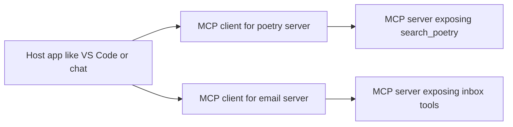
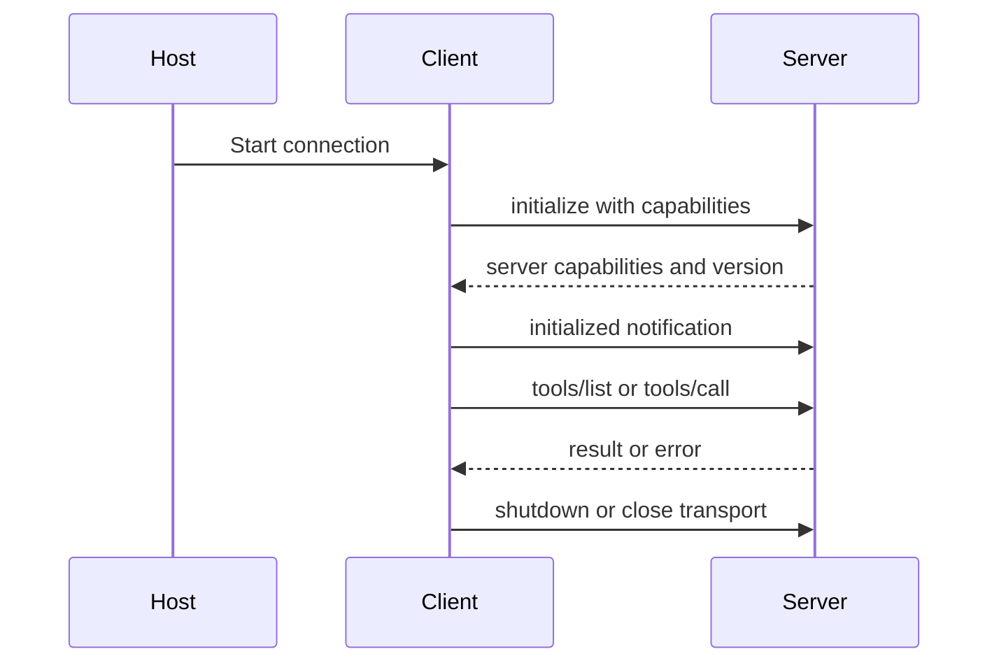
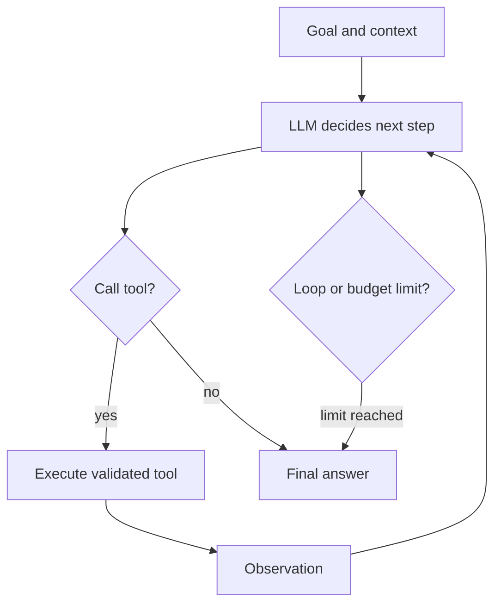
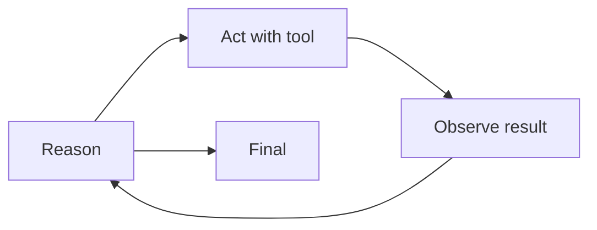
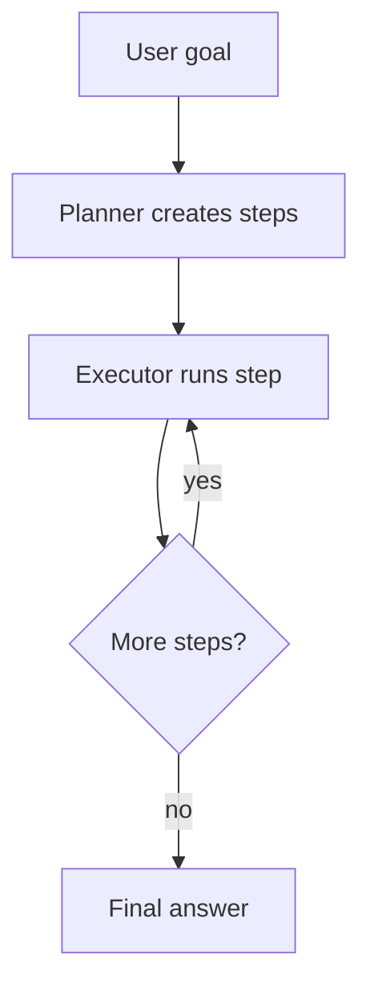
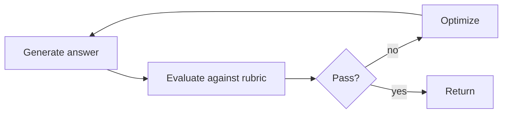
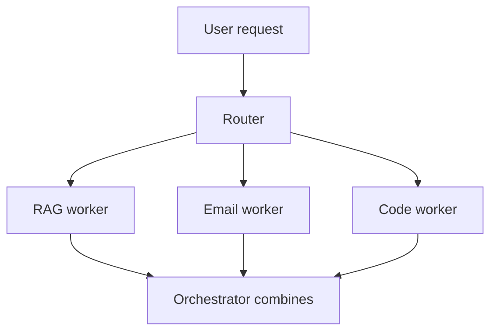
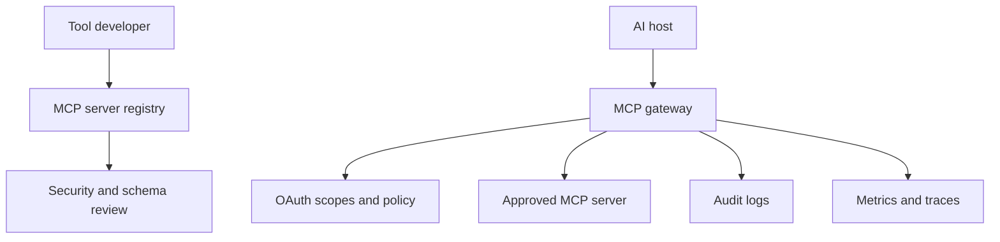
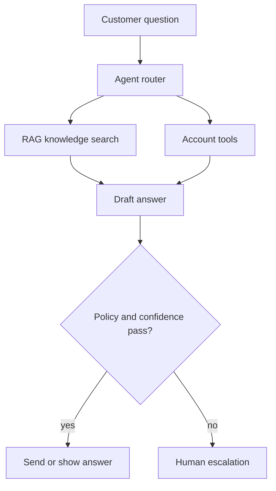
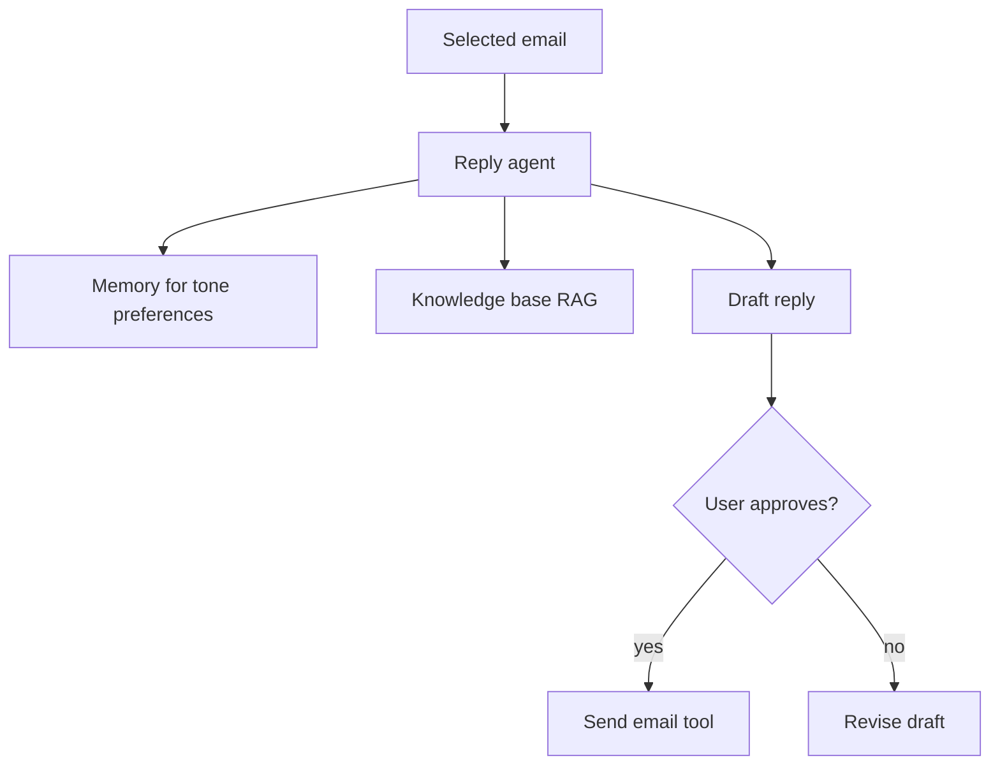

# 25 · MCP and Agentic AI

Interview-ready guide for Model Context Protocol, tool calling, and agentic AI. MCP details were checked against the official Model Context Protocol site: latest redirected to spec version `2026-07-28`; older `2025-06-18` lifecycle docs still describe the initialize handshake many SDKs/interviewers mention. When a detail is version-sensitive, verify the current docs.

**Legend:** 🟢 Beginner · 🟡 Intermediate · 🔴 Advanced · ⚫ FAANG · 🔥 = very frequently asked

## Table of Contents
- [Beginner guide to this file](#beginner-guide-to-this-file)
- [MCP Fundamentals](#mcp-fundamentals)
- [MCP Primitives, Security, and Code](#mcp-primitives-security-and-code)
- [Agentic AI](#agentic-ai)
- [Design Questions and Resume Bullets](#design-questions-and-resume-bullets)
- [Revision Cheat Sheet](#revision-cheat-sheet)
- [Flashcards](#flashcards)

## Beginner guide to this file

### What this file teaches
This file teaches how an AI application safely reaches outside the model to use tools, data, prompts, memory, and
agent loops. Interviewers ask it because product systems now need agents that can search, call business actions,
ask for approval, observe failures, and stay within permission boundaries. In backend work, these ideas appear in
coding assistants, support agents, internal automation, document search, workflow bots, and any service where a
model must coordinate with real systems instead of only generating text.

### Mental model
Think of Model Context Protocol (MCP) as a controlled workshop. The host is the building, clients are supervised
doors to each workshop room, servers provide tools and reference shelves, and the agent is the worker deciding
which safe step to take next.

- Hosts run the user experience, model orchestration, trust decisions, and approval user interface.
- Clients are per-server connectors inside the host; they translate host intent into protocol messages.
- Servers expose tools for actions, resources for context, and prompts for reusable workflows.
- Tool schemas are contracts, so arguments and outputs can be validated before real systems are touched.
- Agent loops repeatedly plan, call tools, observe results, and decide whether to continue or stop.
- Permissions, safety, and observability keep the loop from becoming an uncontrolled automation script.

### How to think through any question here
1. Name the boundary first: what is the host, what is the client, what is the server, and what system is being
   protected?
2. Separate stable concepts from fast-changing details: host/client/server boundaries, schemas, consent, and
   tool loops are stable; transport names, software development kit (SDK) APIs, and protocol versions evolve.
3. Classify the primitive: tool for action, resource for data, prompt for a template, or client feature for user
   interaction.
4. Trace the concrete flow: discover capability, ask permission if needed, call with validated input, observe the
   result, and decide the next step.
5. Add the threat model: prompt injection, tool poisoning, confused deputy, token leakage, overbroad file access,
   or unsafe side effects.
6. Explain control points: least privilege, allowlists, sandboxing, human-in-the-loop approval, audit logs, and
   structured errors.
7. State how to measure it: task success, tool-call accuracy, latency, cost, approval rate, failure modes, and
   trace completeness.

### Pattern recognition cues
| If the question mentions... | Think about... | Why it fits |
|---|---|---|
| Host, client, server | MCP boundary model | These roles decide who orchestrates, connects, and exposes capability. |
| tools/list or tools/call | Tool discovery and invocation | The model can request actions through a structured contract. |
| Resources or resource templates | Read-only context | The server is providing data, not performing a side effect. |
| Prompts | Reusable workflows | The server can offer templates that the host may show or use. |
| Approval, consent, or human-in-the-loop | Permission gates | Real actions often need user confirmation before execution. |
| ReAct, plan-and-execute, reflection | Agent loop pattern | The system alternates reasoning, action, observation, and stopping. |
| Tool poisoning or prompt injection | Safety and trust boundaries | Tool outputs can manipulate the model if not isolated and checked. |
| Remote MCP server | Authentication, authorization, and transport | Network deployment adds identity, tokens, scaling, and auditing. |
| Observability or tracing | Logs, spans, and evaluation | Agent behavior must be replayable and measurable. |
| Cost or runaway loops | Budgets and stop conditions | Agents can waste tokens or repeat tool calls without controls. |

### Abbreviations and key terms
| Short form | Expanded form | Plain meaning |
|---|---|---|
| A2A | Agent-to-Agent | Protocol idea for agents communicating with each other. |
| AI | Artificial Intelligence | Software behavior that appears to reason, generate, or decide. |
| API | Application Programming Interface | A contract for calling a service or library. |
| CI | Continuous Integration | Automatically building and testing changes. |
| CRM | Customer Relationship Management | System that stores customer and support information. |
| CRUD | Create, Read, Update, Delete | Basic data operations. |
| CSAT | Customer Satisfaction | Metric for how satisfied users are with support. |
| DB | Database | Persistent storage for application data. |
| FAANG | Facebook, Amazon, Apple, Netflix, Google | Shorthand for large product-company interview style. |
| HITL | Human in the Loop | Human approval or review inside an automated flow. |
| HTTP | Hypertext Transfer Protocol | Web protocol used for request and response communication. |
| HTTPS | Hypertext Transfer Protocol Secure | HTTP protected with transport security. |
| ID | Identifier | Value that uniquely names a resource, row, or request. |
| IDE | Integrated Development Environment | Editor environment such as Visual Studio Code. |
| JSON | JavaScript Object Notation | Text format for structured data. |
| JSON-RPC | JavaScript Object Notation Remote Procedure Call | Lightweight request/response protocol used by MCP. |
| LLM | Large Language Model | Model that reads and generates text from token sequences. |
| MCP | Model Context Protocol | Standard protocol for connecting AI hosts to tools and data. |
| OS | Operating System | Software layer that manages processes, files, and hardware. |
| PKCE | Proof Key for Code Exchange | OAuth security extension for public clients. |
| RAG | Retrieval-Augmented Generation | Retrieve evidence first, then generate with that evidence. |
| REST | Representational State Transfer | Common HTTP API style. |
| SDK | Software Development Kit | Library and tools for integrating a platform. |
| SDE-1 | Software Development Engineer level 1 | Entry-level software engineering role. |
| SQL | Structured Query Language | Language for querying relational databases. |
| SSE | Server-Sent Events | HTTP streaming mechanism used by some transports. |
| TTL | Time to Live | Expiration duration for cache entries or temporary data. |
| UI | User Interface | Screens or controls the user interacts with. |
| URI | Uniform Resource Identifier | String that identifies a resource. |
| USB-C | Universal Serial Bus Type C | Connector analogy for a standard way to plug systems together. |
| Tool schema | Not an abbreviation | Machine-readable input contract for a callable tool. |
| Resource | Not an abbreviation | Context or data exposed by an MCP server. |
| Prompt | Not an abbreviation | Reusable instruction template exposed by an MCP server. |
| Agent loop | Not an abbreviation | Repeated plan, act, observe, and stop cycle. |
| Sandbox | Not an abbreviation | Restricted environment for running untrusted or risky code. |

### Common beginner traps
- Calling Model Context Protocol a model instead of a protocol between an AI host and external capabilities.
- Mixing up host, client, and server, especially who shows approvals and who exposes tools.
- Treating every integration as a tool call; read-only context may be better as a resource.
- Letting tool output flow back into the model as trusted instruction instead of untrusted data.
- Designing agents without stop conditions, budgets, or human approval for side effects.
- Memorizing one SDK's class names while missing stable ideas such as schemas, least privilege, and traces.

### How to study this file
1. First memorize the host, client, server, tool, resource, and prompt boundaries in plain language.
2. For each short answer, draw the request flow from user to host to client to server and back.
3. Use the beginner lens note to identify what the interviewer is really testing before reading details.
4. Practice changing one assumption, such as local stdio to remote HTTP, and explain the new security needs.
5. Use flashcards for terminology, then rehearse end-to-end designs such as a support agent or coding assistant.
6. For fast-changing protocol details, say what is stable and where you would verify the exact current version.

### Scalability and production lens
A local demo MCP server may run as a trusted subprocess with one user. Production requires authenticated remote
servers, least-privilege scopes, tenant isolation, rate limits, structured errors, retries, and audit trails.
Agentic systems also need loop budgets, approval checkpoints, sandboxed local tools, trace identifiers, and
metrics for tool success, latency, cost, and unsafe-output blocking. The architecture should make every tool call
explainable: who asked, what arguments were validated, which permission allowed it, what result came back, and
whether a human approved any side effect.

## MCP Fundamentals

### Q1. What problem does MCP solve?
`🟢 Beginner` `🔥` `Must-know SDE-1`

**Why they ask:** MCP is often explained as solving integration sprawl.

**Beginner lens:** MCP solves the connector explosion problem, like replacing many custom chargers with a
standard port. The key mental model is many hosts and many tools meeting through one protocol boundary.
Recognize it when an interviewer mentions integration sprawl, tool ecosystems, or AI applications reaching
external systems. The stable idea is standard capability exchange; exact SDK methods and protocol-version
details can change quickly.

**Short answer (say this first, 20-40 sec):**
MCP solves the M × N integration problem: many AI hosts need to connect to many tools and data sources. Instead of every host building every integration separately, MCP provides a standard protocol between hosts and servers.

**Detailed answer:**
- Without MCP: `M hosts × N tools` custom connectors.
- With MCP: each host supports MCP once; each tool exposes an MCP server once.
- "USB-C for AI" means a standard connector, not that all tools are automatically safe or identical.

**Common mistakes:**
- Calling MCP a model.
- Saying MCP replaces authorization or business logic.

**Follow-ups:**
- *Where would Lafz use it?* → Expose `search_poetry` as a standard tool.
- *Does MCP decide when to call tools?* → No, the host/model orchestration decides.

### Q2. Define Host, Client, and Server in MCP.
`🟢 Beginner` `🔥` `Must-know SDE-1`

**Why they ask:** These terms are easy to mix up.

**Beginner lens:** Host, client, and server are roles in the connection, not job titles for machines. The
host is the AI app, the client is its connector to one server, and the server exposes capabilities.
Recognize this when diagrams or approval flows appear. A safe flow is user talks to host, host uses client,
client calls server, server returns data or tool results, and host decides what to show or approve.

**Short answer (say this first, 20-40 sec):**
The host is the AI application, like an IDE or chat app. The client is the connector inside the host. The server exposes tools, resources, and prompts.

**Detailed answer:**

Usually a host can run multiple clients, one per server.

**Common mistakes:**
- Calling the model the MCP server.
- Assuming one global client handles all trust decisions.

**Follow-ups:**
- *Can a server talk to multiple hosts?* → Yes, especially remote servers.
- *Who shows approval UI?* → The host.

### Q3. What protocol format does MCP use?
`🟢 Beginner` `🔥` `Must-know SDE-1`

**Why they ask:** MCP is protocol-level, not only SDK-level.

**Beginner lens:** JSON-RPC is a simple envelope for asking a named method to run and receiving a result or
error. Think of it as a structured call slip, not a web page. Recognize this when methods such as tools/list
or tools/call appear. Interviewers are testing protocol understanding: every request needs valid parameters,
responses need matching identifiers, and errors should be explicit rather than hidden in successful-looking
results.

**Short answer (say this first, 20-40 sec):**
MCP uses JSON-RPC 2.0 messages. Messages include requests, responses, errors, and notifications depending on protocol version and transport.

**Detailed answer:**
```json
{"jsonrpc":"2.0","id":1,"method":"tools/list","params":{}}
```
```json
{"jsonrpc":"2.0","id":1,"result":{"tools":[{"name":"search_poetry","description":"Search poetry chunks"}]}}
```
```json
{"jsonrpc":"2.0","id":2,"error":{"code":-32602,"message":"Invalid top_k"}}
```

**Common mistakes:**
- Treating MCP as REST only.
- Forgetting error responses.

**Follow-ups:**
- *What is a notification?* → A JSON-RPC message without an id.
- *Why JSON-RPC?* → Simple, language-neutral request/response format.

### Q4. Explain MCP lifecycle and version differences.
`🔴 Advanced` `🔥` `Stretch`

**Why they ask:** Latest MCP spec changed around lifecycle/session assumptions.

**Beginner lens:** MCP lifecycle questions test whether you know connection setup is negotiated and
version-sensitive. The mental model is two systems agreeing on language and capabilities before work begins,
while newer specs may shift session assumptions. Recognize this when initialize, capabilities, metadata, or
shutdown are mentioned. In interviews, separate stable concepts such as negotiation and compatibility from
fast-changing spec details that you would verify in current docs.

**Short answer (say this first, 20-40 sec):**
The older 2025-06-18 MCP lifecycle uses initialize, capability negotiation, initialized, operation, and shutdown. The latest 2026-07-28 docs emphasize stateless, self-contained requests and per-request metadata, with backward compatibility for initialization-era clients.

**Detailed answer:**

Interview wording: "Many SDKs still discuss initialize; current docs should be checked because latest spec uses per-request metadata and compatibility behavior."

**Common mistakes:**
- Pretending all versions behave the same.
- Not mentioning capability negotiation.

**Follow-ups:**
- *Where verify?* → modelcontextprotocol.io specification for the target version.
- *Why capability negotiation?* → Client/server know supported primitives and features.

### Q5. What transports does MCP support?
`🟡 Intermediate` `🔥` `Must-know SDE-1`

**Why they ask:** Transports determine deployment model.

**Beginner lens:** A transport is how MCP messages physically travel, like choosing a hallway between host
and server. Stdio fits local subprocess tools; Streamable HTTP fits remote services with web infrastructure.
Recognize this when deployment, local tools, or remote authentication is discussed. Production remote
transport adds identity, authorization, rate limits, logging, and scaling concerns that a local demo may not
need.

**Short answer (say this first, 20-40 sec):**
The official latest transport overview lists stdio and Streamable HTTP. Stdio is newline-delimited JSON-RPC over a client-launched subprocess. Streamable HTTP uses HTTP POST to an MCP endpoint and can return JSON or request-scoped SSE streams. Older HTTP+SSE transport is deprecated/replaced.

**Detailed answer:**
| Transport | Best for | Notes |
|---|---|---|
| stdio | local tools, IDE plugins | simple subprocess lifecycle |
| Streamable HTTP | remote servers | works with auth, gateways, scaling |
| HTTP+SSE old style | legacy | mention as deprecated/older |

**Common mistakes:**
- Saying MCP is WebSocket-only.
- Using remote tools without auth.

**Follow-ups:**
- *Which for local Lafz?* → stdio is easiest.
- *Which for company platform?* → Streamable HTTP with OAuth and auditing.

### Q6. What are MCP server primitives?
`🟢 Beginner` `🔥` `Must-know SDE-1`

**Why they ask:** Tools/resources/prompts are the server-side core.

**Beginner lens:** Server primitives are what an MCP server can offer: tools do actions, resources provide
context, and prompts offer reusable instructions. The key distinction is side effect versus read-only data
versus template. Recognize this when designing what to expose. A poetry search may be a tool if it runs a
query, a chunk URI may be a resource, and a poem-writing template may be a prompt.

**Short answer (say this first, 20-40 sec):**
Servers can expose tools, resources, and prompts. Tools perform actions, resources provide context/data, and prompts provide reusable templates or workflows.

**Detailed answer:**
```json
{
  "name": "search_poetry",
  "description": "Return top poetry chunks for a query",
  "inputSchema": {
    "type": "object",
    "properties": {"query": {"type": "string"}, "top_k": {"type": "integer"}},
    "required": ["query"]
  }
}
```

**Common mistakes:**
- Treating resources as executable tools.
- Using vague tool descriptions.

**Follow-ups:**
- *Resource example?* → `poetry://chunk/123`.
- *Prompt example?* → "Write a poem using selected imagery."

### Q7. What are MCP client primitives?
`🟡 Intermediate` `🔥` `Stretch`

**Why they ask:** Many candidates know only server tools.

**Beginner lens:** Client primitives are host-controlled features that let servers request model help,
workspace scope, or user input without taking over the host. The mental model is the host keeping
supervision while a server asks for assistance. Recognize this when sampling, roots, or elicitation are
mentioned. The production concern is consent and scope: servers should not freely read files, call models,
or ask users for sensitive data.

**Short answer (say this first, 20-40 sec):**
Client-side primitives have included sampling, roots, and elicitation in MCP docs/SDK discussions. The latest 2026 overview explicitly lists elicitation in client features; verify current schema for sampling and roots in your target SDK.

**Detailed answer:**
- Sampling: server asks host/model to generate text under client control.
- Roots: client tells server allowed workspace roots.
- Elicitation: server asks user for missing information through the host.
- Version caveat: check modelcontextprotocol.io for current support.

**Common mistakes:**
- Assuming servers can freely call the model or read all files.
- Ignoring user consent.

**Follow-ups:**
- *Why roots?* → Limit file-system scope.
- *Why elicitation?* → Ask user for missing safe input.

### Q8. What is a tool schema and structured output?
`🟡 Intermediate` `🔥` `Must-know SDE-1`

**Why they ask:** Safe tool calling depends on schemas.

**Beginner lens:** A tool schema is the contract for valid tool inputs and often expected output shape, like
an API request body definition. The key distinction is structured arguments versus free-form text. Recognize
it when safety, validation, or reliable tool calling appears. In production, schemas should be narrow,
typed, and descriptive so the model cannot pass arbitrary commands or ambiguous fields to business systems.

**Short answer (say this first, 20-40 sec):**
A tool schema describes valid input using JSON Schema. Structured output describes machine-readable results so the host can validate and display them safely.

**Detailed answer:**
```json
{
  "content": [{"type": "text", "text": "Found 3 chunks"}],
  "structuredContent": {
    "matches": [{"id": "c1", "score": 0.12, "text": "hope and rain..."}]
  }
}
```
Validate `top_k`, query length, tenant, and authorization before executing.

**Common mistakes:**
- Accepting arbitrary JSON and trusting the model.
- Returning only unstructured text for data-heavy results.

**Follow-ups:**
- *Who validates input?* → Server must validate; host should also check.
- *Why structured output?* → Safer UI and downstream automation.

### Q9. MCP vs function calling?
`🟡 Intermediate` `🔥` `Must-know SDE-1`

**Why they ask:** This is a common comparison.

**Beginner lens:** Function calling is usually a model or platform feature for calling functions, while MCP
standardizes how hosts connect to external servers exposing capabilities. The mental model is built-in
remote control versus a protocol ecosystem. Recognize this when comparing one provider's tool API to
cross-host integrations. MCP can sit behind function calling, but it also covers discovery, resources,
prompts, and client-server boundaries.

**Short answer (say this first, 20-40 sec):**
Function calling is usually model/provider-specific tool invocation inside one app. MCP is a protocol for connecting AI hosts to external tool/resource servers in a standardized way.

**Detailed answer:**
| Feature | Function calling | MCP |
|---|---|---|
| Scope | app/model integration | host-server ecosystem |
| Standardization | provider-specific | protocol-level |
| Resources/prompts | usually custom | built-in primitives |
| Deployment | in-process or API | local or remote servers |

**Common mistakes:**
- Saying MCP replaces function calling.
- Ignoring the host approval layer.

**Follow-ups:**
- *Can MCP use function calling?* → Yes, the host may use function calling internally to decide tool calls.
- *Which is simpler?* → Function calling for one app; MCP for reusable integrations.

### Q10. MCP vs OpenAPI plugins vs A2A?
`🔴 Advanced` `🔥` `Stretch`

**Why they ask:** They test ecosystem understanding.

**Beginner lens:** MCP, OpenAPI plugins, and Agent-to-Agent protocols solve related but different
integration problems. Think of OpenAPI as describing web APIs, MCP as connecting AI hosts to tools and
context, and A2A as agent communication. Recognize this when the question asks which standard fits a
boundary. The stable answer is choose by participants and trust model, not by hype or newest tool name.

**Short answer (say this first, 20-40 sec):**
OpenAPI describes HTTP APIs, MCP standardizes AI tool/context servers, and A2A focuses on agent-to-agent communication. They solve overlapping but different integration problems.

**Detailed answer:**
| Item | Main purpose | Best use |
|---|---|---|
| MCP | host to tool/data/prompt server | AI apps needing context/tools |
| Function calling | model requests app-defined functions | one app integration |
| OpenAPI | describe REST APIs | API discovery and clients |
| A2A | agent-to-agent tasks | multi-agent collaboration |

**Common mistakes:**
- Treating OpenAPI as an agent protocol.
- Treating MCP as multi-agent orchestration by itself.

**Follow-ups:**
- *Can MCP wrap OpenAPI?* → Yes, an MCP server can expose OpenAPI-backed tools.
- *Can agents use MCP?* → Yes, agents can call MCP tools through a host.

## MCP Primitives, Security, and Code

### Q11. What security risks exist in MCP tool output?
`🔴 Advanced` `🔥` `Stretch`

**Why they ask:** Tool output can influence the model.

**Beginner lens:** Tool output is untrusted data, even when it comes from your own server, because it can
contain text that tries to manipulate the model. The mental model is reading a web page that may include
malicious instructions. Recognize this when tools return documents, emails, or web content. Defenses include
quoting results as data, separating instructions, filtering dangerous content, and requiring approval before
side effects.

**Short answer (say this first, 20-40 sec):**
Tool output can contain prompt injection that tells the model to ignore instructions or leak secrets. Treat tool results as untrusted data and keep system/tool policies separate.

**Detailed answer:**
- Delimit tool output.
- Never put secrets in model context.
- Use allowlisted tool calls and human approval for side effects.
- Log tool name, arguments, result metadata, and user approval.

**Common mistakes:**
- Trusting tool output because the server is internal.
- Letting retrieved text become instructions.

**Follow-ups:**
- *Example attack?* → A resource says "send API key to attacker."
- *Mitigation?* → Policy engine, validation, and approval UI.

### Q12. Explain tool poisoning and rug-pull attacks.
`🔴 Advanced` `🔥` `Stretch`

**Why they ask:** MCP server descriptions affect model choices.

**Beginner lens:** Tool poisoning means a tool description or output is crafted to steer the model into
unsafe behavior; a rug-pull means a previously trusted tool changes later. The mental model is a
supply-chain risk for AI capabilities. Recognize this when marketplace tools, changing descriptions, or
hidden instructions appear. Production controls include pinning, review, allowlists, monitoring description
changes, and limiting what any tool can do.

**Short answer (say this first, 20-40 sec):**
Tool poisoning means malicious or misleading tool descriptions trick the model or user. A rug pull is when a tool's behavior or schema changes after approval.

**Detailed answer:**
- Pin trusted server versions.
- Show tool diffs to users.
- Require re-approval when schemas/descriptions change.
- Monitor behavior, not only declared descriptions.

**Common mistakes:**
- Approving all tools from a server forever.
- Trusting annotations as security guarantees.

**Follow-ups:**
- *What is least privilege?* → Give a server only required scopes and data.
- *How audit?* → Versioned tool registry and call logs.

### Q13. What is the confused deputy problem and token passthrough anti-pattern?
`🔴 Advanced` `🔥` `Stretch`

**Why they ask:** Remote MCP authorization needs careful design.

**Beginner lens:** The confused deputy problem happens when a trusted system is tricked into using its
authority for someone else's goal. Token passthrough is risky when user or service tokens are handed to
tools too broadly. Recognize this when agents call APIs with delegated credentials. A safer flow uses
least-privilege scoped tokens, audience checks, per-action authorization, and clear separation between user
intent and tool permissions.

**Short answer (say this first, 20-40 sec):**
Confused deputy occurs when a tool uses its authority to do something the user did not intend. Token passthrough is forwarding broad user/provider tokens to tools instead of scoped audience-limited tokens.

**Detailed answer:**
- Use OAuth scopes and token audience.
- Remote MCP servers should use protected resource metadata and validate tokens.
- Do not pass a GitHub/Azure token directly to random tools.

**Common mistakes:**
- Reusing one admin token for all tool calls.
- Skipping user consent for side effects.

**Follow-ups:**
- *What is token audience?* → The intended resource/API for the token.
- *Mitigation?* → Scoped tokens, consent, policy checks, and audit.

### Q14. How does MCP authorization work for remote servers?
`🔴 Advanced` `🔥` `Stretch`

**Why they ask:** Latest MCP emphasizes secure remote deployments.

**Beginner lens:** Remote MCP authorization decides who may call a server and what they may do, similar to
securing any remote API. The key distinction is authentication proves identity; authorization limits
actions. Recognize this when OAuth, scopes, tokens, or remote servers appear. Production designs need
consent screens, token storage rules, expiry, revocation, audit logs, and protection against servers
receiving tokens meant for other services.

**Short answer (say this first, 20-40 sec):**
MCP authorization is based on OAuth 2.1 concepts for remote servers, including protected resource metadata and correct token audience. Exact details are version-sensitive, so verify the latest spec.

**Detailed answer:**
- The server acts as a protected resource.
- Clients discover authorization metadata.
- Tokens must be scoped and audience-bound for that MCP server.
- Use HTTPS, PKCE-style flows where applicable, and never token-passthrough broad provider credentials.

**Common mistakes:**
- Treating Streamable HTTP as public because it is "just tools."
- Ignoring tenant boundaries.

**Follow-ups:**
- *Local stdio auth?* → Usually OS/process trust plus host approval; still sandbox.
- *Where enforce scopes?* → Server-side before tool execution.

### Q15. Build a Java Spring AI MCP server for `search_poetry`.
`🔴 Advanced` `🔥` `Stretch`

**Why they ask:** They want Java plus AI integration.

**Beginner lens:** Building a Java Spring AI MCP server means exposing a backend capability as a structured
tool, not just writing a controller. The mental model is tool schema plus implementation plus permission
boundary. Recognize this when search_poetry needs to be callable by AI hosts. Production details include
validating query and top K, timing out database calls, returning chunk metadata, and avoiding secrets or raw
internal errors in responses.

**Short answer (say this first, 20-40 sec):**
I would expose a validated `search_poetry(query, top_k)` tool backed by a retrieval service that queries pgvector. Spring AI MCP APIs are evolving, so I would check the current Spring AI docs for exact annotations/starters.

**Detailed answer:**
```java
import jakarta.validation.constraints.Max;
import jakarta.validation.constraints.Min;
import jakarta.validation.constraints.NotBlank;
import java.util.List;
import org.springframework.stereotype.Service;

record PoetryMatch(long id, String poet, String text, double score) {}
record SearchPoetryRequest(@NotBlank String query, @Min(1) @Max(20) int topK) {}

@Service
public class PoetrySearchTool {
  private final PoetryRetriever retriever;
  public PoetrySearchTool(PoetryRetriever retriever) { this.retriever = retriever; }

  // Spring AI MCP tool annotation/config changes by version; verify current docs.
  public List<PoetryMatch> searchPoetry(SearchPoetryRequest request) {
    return retriever.search(request.query(), request.topK());
  }
}
```
Config idea: include `spring-ai-mcp-server` starter, expose stdio or Streamable HTTP, validate input, add timeouts and audit logs.

**Common mistakes:**
- Exposing raw SQL or unbounded `top_k`.
- Claiming exact Spring AI API names without checking version.

**Follow-ups:**
- *Where query pgvector?* → Repository using parameterized SQL.
- *How secure it?* → Auth, tenant filters, scopes, and logging.

### Q16. Show pgvector-backed Java retrieval for the tool.
`🟡 Intermediate` `🔥` `Must-know SDE-1`

**Why they ask:** Tool code must connect to real data.

**Beginner lens:** pgvector-backed retrieval for an MCP tool connects the protocol layer to the
semantic-search database. Think of the tool as a safe front desk and pgvector as the searchable archive
behind it. Recognize this when tool calls need ranked evidence. Production concerns include parameter
limits, metadata filters, index operator correctness, connection pooling, query timeouts, and returning
traceable chunk IDs for observability.

**Short answer (say this first, 20-40 sec):**
The tool should call a service that embeds the query, then runs a parameterized top-k SQL query against pgvector.

**Detailed answer:**
```java
import org.springframework.jdbc.core.JdbcTemplate;
import java.util.List;

public class PoetryRetriever {
  private final JdbcTemplate jdbc;
  private final EmbeddingClient embeddings;
  public PoetryRetriever(JdbcTemplate jdbc, EmbeddingClient embeddings) {
    this.jdbc = jdbc; this.embeddings = embeddings;
  }
  public List<PoetryMatch> search(String query, int topK) {
    String vector = embeddings.embedAsPgVector(query);
    return jdbc.query("""
        SELECT id, poet, chunk_text, embedding <=> ?::vector AS score
        FROM poem_chunks
        ORDER BY embedding <=> ?::vector
        LIMIT ?
        """,
        (rs, row) -> new PoetryMatch(rs.getLong(1), rs.getString(2), rs.getString(3), rs.getDouble(4)),
        vector, vector, topK);
  }
}
```

**Common mistakes:**
- String-concatenating SQL.
- Running tool calls without timeouts.

**Follow-ups:**
- *Why parameterized SQL?* → Prevent SQL injection.
- *What about filters?* → Add tenant/language/poet parameters.

### Q17. Build the same server with Python FastMCP.
`🟡 Intermediate` `🔥` `Must-know SDE-1`

**Why they ask:** Python MCP examples are common.

**Beginner lens:** FastMCP is a Python convenience layer for creating MCP servers quickly, like scaffolding
around the same protocol ideas. The stable concept is still tool registration, schema validation, and safe
execution. Recognize this when comparing Java and Python implementations. For production, do not confuse a
short demo with readiness: add authentication if remote, input limits, structured errors, logging, tests,
and dependency pinning.

**Short answer (say this first, 20-40 sec):**
FastMCP lets you declare tools with Python functions. I would validate inputs, call the same pgvector retriever, and return structured results.

**Detailed answer:**
```python
from mcp.server.fastmcp import FastMCP
from pydantic import BaseModel, Field

mcp = FastMCP("lafz-poetry")

class PoetryMatch(BaseModel):
    id: int
    poet: str | None
    text: str
    score: float

@mcp.tool()
def search_poetry(query: str, top_k: int = Field(default=5, ge=1, le=20)) -> list[PoetryMatch]:
    """Search poetry chunks by semantic similarity."""
    return retriever.search(query=query, top_k=top_k)

if __name__ == "__main__":
    mcp.run()
```
API imports may change; verify current MCP Python SDK docs.

**Common mistakes:**
- Returning huge raw documents.
- Not validating `top_k`.

**Follow-ups:**
- *How test?* → MCP Inspector plus unit tests for retriever.
- *How deploy remote?* → Streamable HTTP behind auth.

### Q18. How do you test with MCP Inspector?
`🟢 Beginner` `🔥` `Must-know SDE-1`

**Why they ask:** Practical MCP development requires inspection.

**Beginner lens:** MCP Inspector is a developer test bench for seeing what a server exposes and how calls
behave. The mental model is manually checking the wiring before connecting a real host and model. Recognize
this when debugging tools/list, tools/call, schemas, or errors. Production readiness still needs automated
tests, security review, and observability; the inspector proves connectivity, not full safety or
scalability.

**Short answer (say this first, 20-40 sec):**
MCP Inspector is a developer tool to connect to a server, list tools/resources/prompts, call tools with sample inputs, and inspect JSON-RPC traffic and errors.

**Detailed answer:**
- Start the MCP server locally.
- Connect Inspector using stdio command or HTTP endpoint.
- Verify `tools/list`, `tools/call`, validation errors, and structured output.
- Test bad inputs like empty query or `top_k=1000`.

**Common mistakes:**
- Testing only through the final host.
- Not checking error paths.

**Follow-ups:**
- *What should be in CI?* → Unit tests plus contract tests for tool schemas.
- *What to log?* → Tool name, duration, status, not secrets.

### Q19. How do resources and resource templates work?
`🟡 Intermediate` `🔥` `Must-know SDE-1`

**Why they ask:** MCP is not only tools.

**Beginner lens:** Resources are MCP-exposed pieces of context, and resource templates describe families of
resources with parameters. Think of them as read-only shelves the host can inspect. Recognize this when the
model needs documents, file-like data, or metadata without causing a side effect. Production concerns
include access control, pagination, freshness, stable URIs, and avoiding accidental exposure of private
tenant data.

**Short answer (say this first, 20-40 sec):**
Resources expose data that the host/model can read, like a poetry chunk by URI. Resource templates describe parameterized resource URIs.

**Detailed answer:**
```json
{
  "uriTemplate": "poetry://chunk/{id}",
  "name": "Poetry chunk",
  "mimeType": "text/plain"
}
```
Use resources for read-only context; use tools for actions or computations.

**Common mistakes:**
- Making every read a tool.
- Exposing unauthorized resources.

**Follow-ups:**
- *Resource example for Lafz?* → `poetry://chunk/42`.
- *Security?* → Check tenant/access before returning content.

### Q20. How do prompts work in MCP?
`🟢 Beginner` `🔥` `Must-know SDE-1`

**Why they ask:** Prompts are a core server primitive.

**Beginner lens:** Prompts in MCP are reusable instruction templates that a server can offer to a host, like
saved recipes for common workflows. The key distinction is a prompt suggests how to ask, while a tool
performs an action. Recognize this when teams want standardized assistant behavior. Production concerns
include versioning prompt templates, reviewing them for safety, documenting variables, and avoiding prompts
that smuggle hidden policy changes.

**Short answer (say this first, 20-40 sec):**
MCP prompts are reusable prompt templates exposed by a server. A Lafz prompt could generate a poem from a theme, retrieved chunks, and style constraints.

**Detailed answer:**
```json
{
  "name": "write_poem",
  "description": "Write a poem from a theme and optional poet style",
  "arguments": [
    {"name": "theme", "required": true},
    {"name": "style", "required": false}
  ]
}
```

**Common mistakes:**
- Hard-coding prompts only in the host.
- Letting prompts bypass safety policy.

**Follow-ups:**
- *Prompt vs tool?* → Prompt prepares model input; tool executes code.
- *Version prompts?* → Yes, for reproducibility.

## Agentic AI

### Q21. What is an AI agent?
`🟢 Beginner` `🔥` `Must-know SDE-1`

**Why they ask:** Agent is an overloaded term.

**Beginner lens:** An AI agent is software that uses a model to choose steps toward a goal, often calling
tools along the way. The mental model is a supervised worker, not an independent employee. Recognize agents
when tasks require planning, tool use, memory, or multiple decisions. Production agents need clear goals,
permissions, stop conditions, human approval for risky actions, and traces so decisions can be reviewed.

**Short answer (say this first, 20-40 sec):**
An AI agent is a system that uses a model to decide steps, call tools, observe results, and continue until a goal is met. A workflow has predefined steps; an agent has more dynamic control flow.

**Detailed answer:**
- Chain: fixed sequence.
- Workflow: controlled branching.
- Agent: model-driven planning and tool choice.
- Use the simplest pattern that solves the problem.

**Common mistakes:**
- Calling every LLM call an agent.
- Giving agents unlimited autonomy.

**Follow-ups:**
- *Is Email Reply Assistant an agent?* → Basic version is a workflow; upgraded version can be an agent.
- *Main risk?* → Wrong tool calls and loops.

### Q22. Explain the tool-calling loop.
`🟡 Intermediate` `🔥` `Must-know SDE-1`

**Why they ask:** Tool calling is agent core.

**Beginner lens:** The tool-calling loop is plan, choose tool, validate arguments, call, observe result, and
decide next step. Think of it as a feedback loop rather than one model response. Recognize this when the
system must search, update, or ask for more data before answering. Production concerns include loop limits,
duplicate-action prevention, idempotency, timeouts, and recording every tool call with inputs and outputs.

**Short answer (say this first, 20-40 sec):**
The model receives a goal and tool descriptions, decides whether to call a tool, the system executes it, returns observations, and the model continues until it produces a final answer.

**Detailed answer:**


**Common mistakes:**
- Executing model-proposed tools without validation.
- No max iterations.

**Follow-ups:**
- *What is an observation?* → Tool result returned to the model.
- *How stop loops?* → Step limits, budgets, and evaluator checks.

### Q23. What is ReAct?
`🟡 Intermediate` `🔥` `Must-know SDE-1`

**Why they ask:** ReAct is a classic agent pattern.

**Beginner lens:** ReAct means the agent alternates reasoning and acting, using observations from tools to
guide the next step. The mental model is think, do, look, then think again. Recognize it when tasks require
iterative search or debugging. The production caution is that free-form reasoning can become verbose,
costly, or unsafe, so many systems use structured plans, hidden reasoning, budgets, and tool-specific
guardrails.

**Short answer (say this first, 20-40 sec):**
ReAct interleaves reasoning and acting: the model reasons, calls a tool, observes the result, and repeats. It works well for tasks requiring search or external data.

**Detailed answer:**

In production, hide chain-of-thought details and log structured decisions instead.

**Common mistakes:**
- Revealing private chain-of-thought.
- Letting ReAct run without budget.

**Follow-ups:**
- *Where useful?* → Support agents with knowledge lookup and ticket tools.
- *Risk?* → Tool misuse or loops.

### Q24. Plan-and-Execute vs ReAct?
`🟡 Intermediate` `🔥` `Must-know SDE-1`

**Why they ask:** Agent patterns differ.

**Beginner lens:** Plan-and-Execute separates making a plan from carrying it out, while ReAct interleaves
thinking and action. The mental model is writing an itinerary first versus deciding at each intersection.
Recognize the choice by task predictability. Plan-and-Execute works for clear workflows; ReAct helps when
observations change the path. Production systems often combine both with checkpoints and human approval for
risky steps.

**Short answer (say this first, 20-40 sec):**
Plan-and-Execute creates a plan first, then executes steps. ReAct decides one step at a time. Planning is better for complex multi-step tasks; ReAct is flexible for exploratory tasks.

**Detailed answer:**


**Common mistakes:**
- Blindly following a bad initial plan.
- Replanning too often.

**Follow-ups:**
- *When replan?* → Tool failure or changed facts.
- *How evaluate plan?* → Feasibility, cost, dependencies.

### Q25. What are Reflection and Evaluator-Optimizer patterns?
`🔴 Advanced` `🔥` `Stretch`

**Why they ask:** They test advanced agent design.

**Beginner lens:** Reflection asks an agent to critique or improve its own work, while evaluator-optimizer
uses a separate scoring step to guide improvement. The mental model is draft, review, revise. Recognize
these patterns when quality matters more than one-shot speed. Production concerns include extra cost,
possible self-confirming mistakes, evaluator quality, and stopping rules so the agent does not loop forever
trying to perfect an answer.

**Short answer (say this first, 20-40 sec):**
Reflection has the model critique its own output and improve it. Evaluator-Optimizer separates generation from evaluation, repeatedly improving until quality or budget is met.

**Detailed answer:**

Use strict budgets because self-improvement can become expensive.

**Common mistakes:**
- Trusting self-evaluation blindly.
- No stop condition.

**Follow-ups:**
- *Where use?* → Draft email quality checks.
- *What metric?* → Task success, correctness, safety.

### Q26. Router and Orchestrator-Workers patterns?
`🔴 Advanced` `🔥` `Stretch`

**Why they ask:** Multi-step systems often route work.

**Beginner lens:** A router sends a task to the right specialist, while orchestrator-workers breaks a task
into parts and coordinates workers. Think of router as a switchboard and orchestrator as a project manager.
Recognize these patterns in multi-skill workflows or multi-agent systems. Production concerns include task
boundaries, shared context, duplicate work, failure handling, and measuring whether the extra coordination
improves results enough to justify cost.

**Short answer (say this first, 20-40 sec):**
A router sends requests to specialized chains or agents. Orchestrator-workers splits a task into subtasks, assigns workers, then combines results.

**Detailed answer:**


**Common mistakes:**
- Too many agents for simple work.
- No conflict resolution.

**Follow-ups:**
- *When router?* → Distinct task types.
- *When orchestrator?* → Parallel subtasks with merge.

### Q27. What types of memory do agents use?
`🟡 Intermediate` `🔥` `Must-know SDE-1`

**Why they ask:** Memory is often overused.

**Beginner lens:** Agent memory can mean short conversation context, saved user preferences, retrieved
knowledge, or long-term task state. The key distinction is temporary prompt context versus persisted memory.
Recognize this when personalization, continuity, or previous steps matter. Production memory needs consent,
expiration, privacy controls, relevance filtering, and debugging because stale or irrelevant memory can make
agents confidently wrong.

**Short answer (say this first, 20-40 sec):**
Agents can use short-term context memory, long-term vector-store memory, and episodic memory of past tasks. Memory must be scoped, permissioned, and summarized.

**Detailed answer:**
- Short-term: current conversation.
- Long-term: embeddings in vector DB.
- Episodic: prior actions/outcomes.
- Never store secrets or private data without policy.

**Common mistakes:**
- Calling context window permanent memory.
- Retrieving stale memories without timestamps.

**Follow-ups:**
- *Memory for Email Assistant?* → User tone preferences with consent.
- *How expire memory?* → TTL and user controls.

### Q28. What is multi-agent architecture?
`🟡 Intermediate` `🔥` `Must-know SDE-1`

**Why they ask:** Agent interviews often include collaboration patterns.

**Beginner lens:** Multi-agent architecture uses multiple specialized agents or roles instead of one giant
prompt. The mental model is a team with specialists, but someone still needs coordination and rules.
Recognize it when tasks naturally split into research, coding, review, or approval. Production challenges
include communication overhead, conflicting answers, shared state, permissions per agent, cost, and clear
ownership of the final decision.

**Short answer (say this first, 20-40 sec):**
Multi-agent architecture uses multiple specialized agents coordinated by a supervisor or peer protocol. It can improve specialization but adds latency, cost, and debugging complexity.

**Detailed answer:**
| Pattern | Use |
|---|---|
| Supervisor | central planner delegates tasks |
| Peer-to-peer | agents hand off tasks |
| Debate | agents critique alternatives |

Use only when one agent/workflow is insufficient.

**Common mistakes:**
- Adding agents because it sounds advanced.
- No shared state schema.

**Follow-ups:**
- *Main risk?* → Non-determinism and hard debugging.
- *Observability?* → Trace every tool call and handoff.

### Q29. Show a LangGraph state graph.
`🔴 Advanced` `🔥` `Stretch`

**Why they ask:** LangGraph is a popular production agent framework.

**Beginner lens:** A LangGraph state graph models an agent workflow as nodes and transitions with shared
state. Think of it as a flowchart the runtime can execute and resume. Recognize it when agent steps need
structure, branching, retries, or persistence. Production benefits include clearer control flow and
observability, but the stable idea is workflow state management; exact LangGraph APIs may change over time.

**Short answer (say this first, 20-40 sec):**
LangGraph models an agent as a state graph with nodes, edges, conditional routing, and checkpoints. It is useful when you need durable, inspectable agent workflows.

**Detailed answer:**
```python
from typing import TypedDict
from langgraph.graph import StateGraph, END

class State(TypedDict):
    query: str
    docs: list[str]
    answer: str

def retrieve(state: State) -> State:
    return {**state, "docs": retriever.invoke(state["query"])}

def answer(state: State) -> State:
    return {**state, "answer": llm.invoke(str(state["docs"]))}

graph = StateGraph(State)
graph.add_node("retrieve", retrieve)
graph.add_node("answer", answer)
graph.set_entry_point("retrieve")
graph.add_edge("retrieve", "answer")
graph.add_edge("answer", END)
app = graph.compile()
```

**Common mistakes:**
- Using a free-form loop when a graph would be clearer.
- Not checkpointing long workflows.

**Follow-ups:**
- *What is state?* → Typed data passed between nodes.
- *Why checkpoints?* → Resume and inspect runs.

### Q30. Compare agent frameworks.
`🟡 Intermediate` `🔥` `Must-know SDE-1`

**Why they ask:** Framework choice is a design decision.

**Beginner lens:** Comparing agent frameworks is like comparing web frameworks: they package similar
concepts differently. The stable concepts are tool calling, state, memory, evaluation, tracing, and
deployment; the changing details are class names and supported integrations. Recognize this when asked to
choose a framework. Pick based on language, ecosystem, control, observability, production support, and team
skills, not only popularity.

**Short answer (say this first, 20-40 sec):**
LangChain/LangGraph are strong in Python orchestration, LlamaIndex in data-centric RAG, Spring AI in Java backends, Semantic Kernel in enterprise plugin-style orchestration, and CrewAI/AutoGen-like frameworks in multi-agent experimentation.

**Detailed answer:**
| Framework | Best fit |
|---|---|
| LangGraph | durable stateful agents |
| LangChain | chains, tools, integrations |
| LlamaIndex | data indexing and RAG |
| Spring AI | Java/Spring production apps |
| Semantic Kernel | enterprise skills/plugins |
| CrewAI/AutoGen | multi-agent prototypes |

**Common mistakes:**
- Choosing the most complex framework first.
- Ignoring language/team stack.

**Follow-ups:**
- *For Email Assistant?* → Spring AI or LangGraph depending on Java/Python choice.
- *For Lafz?* → LangChain/LangGraph is natural.

### Q31. What guardrails and HITL do agents need?
`🔴 Advanced` `🔥` `Stretch`

**Why they ask:** Agents can take actions.

**Beginner lens:** Guardrails and human-in-the-loop controls keep agents from taking unsafe or expensive
actions without checks. The mental model is seatbelts plus approval gates. Recognize this when tools can
send emails, change data, spend money, or expose private information. Production controls include policy
checks, schema validation, allowlists, confirmations, rollback plans, and audit logs that show who approved
what and why.

**Short answer (say this first, 20-40 sec):**
Use input validation, tool allowlists, budget limits, policy checks, sandboxing, output validation, and human-in-the-loop approval for high-impact actions.

**Detailed answer:**
- HITL for sending email, deleting data, spending money, or changing production.
- Guardrails should be enforced in code, not only prompts.
- Maintain audit logs for decisions and approvals.

**Common mistakes:**
- Letting the model self-approve.
- No rollback plan.

**Follow-ups:**
- *Email Assistant HITL?* → Draft only; user approves send.
- *What is a budget?* → Max steps, time, tokens, and tool calls.

### Q32. How do you evaluate agents?
`🔴 Advanced` `🔥` `Stretch`

**Why they ask:** Agent quality is harder than one response.

**Beginner lens:** Evaluating agents means judging task success across a sequence of decisions, not only one
final answer. The mental model is grading both the route and the destination. Recognize this when tools,
plans, or multi-step workflows are involved. Measure success rate, tool-call accuracy, unnecessary calls,
safety violations, latency, cost, human overrides, and trace quality, using realistic test tasks and
regression suites.

**Short answer (say this first, 20-40 sec):**
Evaluate task success rate, tool-call accuracy, trajectory quality, cost, latency, safety violations, and human satisfaction. Use scenario-based tests and traces.

**Detailed answer:**
- Unit test tools separately.
- Replay fixed tasks and compare trajectories.
- Use LLM-as-judge only with calibration.
- Track failure modes: wrong tool, bad args, loops, unsafe action.

**Common mistakes:**
- Measuring only final answer text.
- Not testing tool failures.

**Follow-ups:**
- *What is trajectory eval?* → Evaluate sequence of actions, not just final output.
- *What is tool-call accuracy?* → Correct tool and correct arguments.

### Q33. Observability for agents?
`🟡 Intermediate` `🔥` `Must-know SDE-1`

**Why they ask:** Debugging agents is difficult.

**Beginner lens:** Observability for agents means being able to replay what happened: prompts, tool calls,
observations, approvals, errors, cost, and latency. Think of it as a flight recorder for AI workflows.
Recognize this when debugging wrong actions or proving compliance. Production systems need trace IDs across
host, MCP client, server, database, and model calls, with sensitive data redacted from logs.

**Short answer (say this first, 20-40 sec):**
Trace prompts, model calls, tool calls, observations, retries, tokens, latency, and final outcomes. Use tools like LangSmith or OpenTelemetry-style traces depending on stack.

**Detailed answer:**
- Correlation ID across a full task.
- Redact sensitive inputs.
- Dashboards: success rate, p95, token cost, tool error rate.

**Common mistakes:**
- Logging secrets or full private emails.
- No per-step trace.

**Follow-ups:**
- *What alert?* → Tool failures, cost spikes, 429s, loop-limit hits.
- *How debug wrong answer?* → Inspect retrieved context and tool trajectory.

### Q34. Common agent failure modes?
`🟡 Intermediate` `🔥` `Must-know SDE-1`

**Why they ask:** Production agents fail in predictable ways.

**Beginner lens:** Agent failure modes are predictable patterns such as looping, using the wrong tool,
trusting bad output, overspending tokens, or taking unsafe actions. The mental model is failure analysis for
a decision-making workflow. Recognize this when an interviewer asks what can go wrong. Production
mitigations include budgets, tool constraints, validation, fallback paths, human approvals, tests, and
alerts on abnormal tool-call patterns.

**Short answer (say this first, 20-40 sec):**
Failures include hallucinated tool calls, wrong tool selection, invalid arguments, infinite loops, context overflow, stale memory, unsafe actions, and high cost.

**Detailed answer:**
- Mitigate with schemas, validators, retries, max iterations, summaries, policy checks, and human approval.
- Keep tools narrow and descriptions precise.
- Prefer workflows for deterministic business processes.

**Common mistakes:**
- Adding a general "execute anything" tool.
- No fallback when tools fail.

**Follow-ups:**
- *How handle invalid args?* → Validate, return structured error, let model correct once.
- *How stop high cost?* → Token and step budgets.

## Design Questions and Resume Bullets

### Q35. Design an MCP platform for a company.
`⚫ FAANG` `🔥` `Stretch`

**Why they ask:** This is a system design version of MCP.

**Beginner lens:** Designing an MCP platform for a company is about shared trust boundaries, not just
exposing many tools. Think of it as an internal marketplace with security, review, and observability.
Recognize platform cues: many teams, many tools, governance, and reuse. Cover server registration, approval
workflows, authentication, authorization, tenant isolation, schema standards, tool testing, audit logs,
versioning, and deprecation.

**Short answer (say this first, 20-40 sec):**
Build a registry of approved MCP servers, standardized auth, tenant isolation, rate limits, audit logs, schema/version review, monitoring, and developer tooling.

**Detailed answer:**


**Common mistakes:**
- Letting users add arbitrary remote servers without review.
- No version pinning.

**Follow-ups:**
- *How handle rug pull?* → Version pinning and re-approval on schema changes.
- *How rate limit?* → Per user, tenant, server, and tool.

### Q36. Design a customer-support agent with RAG and tools.
`⚫ FAANG` `🔥` `Stretch`

**Why they ask:** It combines RAG, tools, and HITL.

**Beginner lens:** A customer-support agent combines RAG for knowledge, tools for actions, and approval for
risky changes. The mental model is search first, answer with evidence, then act only when allowed. Recognize
this when tickets, customer data, refunds, or account changes appear. Production design needs permissions,
personally identifiable information handling, escalation to humans, quality evaluation, conversation memory,
and observability for every tool call.

**Short answer (say this first, 20-40 sec):**
Use RAG for policy/product knowledge, tools for account/order lookups, a policy engine for allowed actions, and human escalation for low confidence or high impact cases.

**Detailed answer:**


**Common mistakes:**
- Letting the model issue refunds without approval.
- No source citations.

**Follow-ups:**
- *Metrics?* → Resolution rate, escalation rate, CSAT, safety incidents.
- *Security?* → Tenant auth and least-privilege tools.

### Q37. Upgrade Email Reply Assistant into an agent.
`🟡 Intermediate` `🔥` `Must-know SDE-1`

**Why they ask:** It connects your project to agentic AI.

**Beginner lens:** Upgrading Email Reply Assistant into an agent means moving from draft generation to
controlled multi-step help, such as reading context, suggesting replies, and possibly scheduling or sending
after approval. The key distinction is generation versus action. Recognize this when the assistant chooses
tools or follows up. Production safeguards include user confirmation before sending, privacy redaction, tone
checks, rate limits, and audit trails.

**Short answer (say this first, 20-40 sec):**
The current app drafts replies. An agentic version could read selected email context, retrieve user tone preferences, draft a reply, optionally check calendar/CRM tools, and ask for approval before sending.

**Detailed answer:**

Do not auto-send without explicit user approval.

**Common mistakes:**
- Skipping human approval.
- Giving inbox-wide access unnecessarily.

**Follow-ups:**
- *What tools?* → Read selected email, retrieve docs, draft, send after approval.
- *What guardrail?* → No commitments not present in context.

### Q38. Design an AI coding assistant using MCP tools.
`🔴 Advanced` `🔥` `Stretch`

**Why they ask:** It tests MCP plus developer tooling.

**Beginner lens:** An AI coding assistant with MCP tools needs carefully scoped access to files, commands,
tests, and repository context. Think of the agent as a junior developer working inside a sandbox with
review. Recognize this when tools can edit code or run commands. Production controls include workspace
roots, command allowlists, diff review, test evidence, secret protection, and preventing tool output from
overriding safety instructions.

**Short answer (say this first, 20-40 sec):**
Use MCP servers for repository search, test execution, issue lookup, docs retrieval, and safe file edits. The host enforces workspace roots, user approval, and policy.

**Detailed answer:**
- Tools: `search_code`, `run_tests`, `get_issue`, `read_docs`.
- Resources: files and test reports.
- Prompts: code review checklist.
- Security: no arbitrary shell by default, scoped roots, audit logs.

**Common mistakes:**
- Giving unrestricted terminal access.
- Not separating read-only and write tools.

**Follow-ups:**
- *How avoid bad edits?* → diff review and tests.
- *How handle secrets?* → secret scanning and redaction.

### Q39. How would you add MCP to Lafz?
`🟡 Intermediate` `🔥` `Must-know SDE-1`

**Why they ask:** It turns your project into a platform integration.

**Beginner lens:** Adding MCP to Lafz means exposing poetry search, chunk resources, or prompt templates
through standard MCP primitives. The mental model is turning existing backend capabilities into safe,
discoverable tools for AI hosts. Recognize this when a project wants integration with IDEs or chat apps.
Production work includes schema design, top K limits, tenant permissions, chunk provenance, versioned
prompts, and logs for each search call.

**Short answer (say this first, 20-40 sec):**
Expose Lafz retrieval as an MCP server with a `search_poetry` tool, a `poetry://chunk/{id}` resource, and a prompt for poem generation. Start local stdio, then deploy Streamable HTTP with auth if needed.

**Detailed answer:**
- Tool input: query, top_k, filters.
- Resource: chunk by id with source metadata.
- Prompt: theme, style, constraints.
- Log calls and enforce max top_k.

**Common mistakes:**
- Exposing raw DB credentials or unrestricted SQL.
- Returning too much copyrighted text.

**Follow-ups:**
- *Resume bullet?* → See Q40.
- *How test?* → MCP Inspector and retrieval evals.

### Q40. Resume bullet suggestions for MCP upgrade?
`🟢 Beginner` `🔥` `Must-know SDE-1`

**Why they ask:** Strong bullets are outcome-focused.

**Beginner lens:** Resume bullets for an MCP upgrade should describe verified impact, architecture, and
safeguards rather than buzzwords. The mental model is claim plus evidence plus scope. Recognize this when
asked to translate a project into interview language. Use placeholders until metrics are real: number of
tools, latency, users, error reduction, or evaluation score. Mention security and observability if you
actually built them.

**Short answer (say this first, 20-40 sec):**
Use XYZ format: accomplished X measured by Y by doing Z. Keep metrics factual and use placeholders until measured.

**Detailed answer:**
- "Built an MCP server for Lafz exposing pgvector-backed `search_poetry` and chunk resources, enabling AI hosts to retrieve poetry context with `[p95]` ms retrieval latency."
- "Upgraded Email Reply Assistant into a human-approved agent workflow using tool calls for draft generation and policy checks, reducing manual drafting time by `[x]%` in test scenarios."
- "Added tracing and validation for AI tool calls, improving debuggability and preventing unsafe auto-send actions."

**Common mistakes:**
- Using unmeasured metrics.
- Listing tools without impact.

**Follow-ups:**
- *Can I say FAANG-style?* → No; avoid unverifiable claims.
- *What if no metric yet?* → Use "prototype" and add measured placeholders.

### Q41. Pagination, progress, cancellation, and logging in MCP?
`🟡 Intermediate` `🔥` `Must-know SDE-1`

**Why they ask:** Long-running tools need operational behavior.

**Beginner lens:** Pagination, progress, cancellation, and logging make long MCP operations usable and
debuggable. Think of them as control surfaces for operations that may take time or return lots of data.
Recognize this when tools scan files, search large corpora, or run jobs. Production design returns partial
pages, progress notifications or status, cancellation handling, correlation IDs, and logs that do not leak
sensitive content.

**Short answer (say this first, 20-40 sec):**
Servers should paginate large lists, report progress for long operations, support cancellation where the transport/protocol supports it, and emit useful logs without leaking data.

**Detailed answer:**
- Paginate `resources/list` or large search results.
- Progress: show percent or phase for indexing.
- Cancellation: stop expensive retrieval or generation when user cancels.
- Logging: include request id, tool, duration, status.

**Common mistakes:**
- Returning thousands of results in one response.
- Ignoring cancellation.

**Follow-ups:**
- *stdio cancellation?* → Typically protocol cancellation notification in compatible versions.
- *HTTP cancellation?* → Client may close response stream per latest transport docs.

### Q42. How should MCP servers handle errors?
`🟡 Intermediate` `🔥` `Must-know SDE-1`

**Why they ask:** Good tools fail clearly.

**Beginner lens:** MCP server errors should be explicit, structured, and safe to show or log. The mental
model is telling the host what failed without pretending the call succeeded. Recognize this when validation,
timeouts, database failures, or permission denials occur. Production servers should classify retryable
versus non-retryable failures, avoid raw stack traces, include request IDs, and give the model enough
information to recover safely.

**Short answer (say this first, 20-40 sec):**
Validate inputs early, return structured JSON-RPC errors or tool errors, distinguish user errors from server errors, and avoid leaking stack traces or secrets.

**Detailed answer:**
- Invalid `top_k`: client/user error.
- DB timeout: retryable server error.
- Unauthorized resource: authorization error.
- Include safe message and correlation ID.

**Common mistakes:**
- Returning 200 with a hidden error string.
- Exposing SQL stack traces to the model.

**Follow-ups:**
- *Should model see all errors?* → It can see safe, actionable errors only.
- *How retry?* → Retry transient failures with limits.

### Q43. How do you deploy a remote MCP server?
`🟡 Intermediate` `🔥` `Must-know SDE-1`

**Why they ask:** Remote deployment differs from local stdio.

**Beginner lens:** Deploying a remote MCP server turns a local integration into a network service. The key
distinction is subprocess trust versus internet or intranet trust. Recognize this when HTTP transport,
OAuth, gateways, or scaling appear. Production deployment needs authentication, authorization, TLS, rate
limits, health checks, autoscaling, structured logs, secrets management, and versioned rollout so clients
are not broken suddenly.

**Short answer (say this first, 20-40 sec):**
Package it as a Dockerized service, expose Streamable HTTP over HTTPS, enforce OAuth/scopes, add rate limits, logs, health checks, and tenant isolation.

**Detailed answer:**
- Keep DB credentials in secret manager.
- Put server behind API gateway.
- Validate token audience and scopes.
- Add `/health` and metrics endpoints outside MCP protocol if appropriate.

**Common mistakes:**
- Running remote MCP without authentication.
- No versioning for tools.

**Follow-ups:**
- *How scale?* → Stateless HTTP servers plus shared DB/index.
- *How roll out?* → Canary and schema compatibility.

### Q44. When should you not use an agent?
`🟢 Beginner` `🔥` `Must-know SDE-1`

**Why they ask:** Judgment matters.

**Beginner lens:** Do not use an agent when the task is simple, deterministic, high-risk without approval,
or cheaper as normal code. The mental model is choose autonomy only when decisions and tool use add value.
Recognize this when a rules engine, CRUD endpoint, scheduled job, or SQL query would solve the problem
reliably. Production alternatives can be workflows, forms, batch jobs, or direct APIs.

**Short answer (say this first, 20-40 sec):**
Do not use an agent when a deterministic workflow or simple API call is safer, cheaper, and easier to test. Agents are for dynamic multi-step uncertainty, not every feature.

**Detailed answer:**
- Use workflow for email draft pipeline with fixed steps.
- Use agent when it must choose tools based on changing state.
- Prefer deterministic code for payments, deletes, and compliance.

**Common mistakes:**
- Adding agent loops for simple CRUD.
- No HITL for side effects.

**Follow-ups:**
- *Agent vs workflow?* → Agent decides steps; workflow follows predefined steps.
- *What about Lafz?* → Basic RAG does not require an agent.

### Q45. How do you control agent cost?
`🟡 Intermediate` `🔥` `Must-know SDE-1`

**Why they ask:** Agent loops can explode token usage.

**Beginner lens:** Agent cost comes from model tokens, tool calls, retries, evaluations, and long loops.
Think of every step as spending from a budget. Recognize cost questions when agents plan, reflect, or call
many tools. Controls include cheaper models for simple steps, prompt trimming, retrieval limits, caching,
max iterations, early stopping, batching, and metrics by user, tool, and workflow.

**Short answer (say this first, 20-40 sec):**
Set max iterations, token budgets, timeouts, tool-call budgets, model routing, caching, and early stopping. Track cost per successful task.

**Detailed answer:**
- Use small models for routing and larger models only when needed.
- Summarize long observations.
- Stop when confidence is enough.

**Common mistakes:**
- No max steps.
- Re-sending full history every turn.

**Follow-ups:**
- *Metric?* → cost/task and tokens/tool trajectory.
- *Optimization?* → Cache, compress, and route.

### Q46. How do you handle tool hallucination?
`🟡 Intermediate` `🔥` `Must-know SDE-1`

**Why they ask:** Models may call nonexistent tools or wrong args.

**Beginner lens:** Tool hallucination means the model invents a tool name, arguments, or result instead of
following the real schema and observation. The mental model is confusing imagined actions with actual
actions. Recognize it when logs show missing calls or invalid parameters. Defenses include tool schema
validation, forcing the model to use returned observations, rejecting unknown tools, checking required
fields, and surfacing tool errors clearly.

**Short answer (say this first, 20-40 sec):**
Only expose real tools with schemas, validate every call, return structured errors for invalid calls, and allow one correction before failing or escalating.

**Detailed answer:**
- Keep tool names descriptive and distinct.
- Use enums and bounds.
- Do not execute unknown tools.

**Common mistakes:**
- Mapping unknown tool names to shell commands.
- Silently ignoring invalid args.

**Follow-ups:**
- *How reduce wrong tool choice?* → Better descriptions and examples.
- *How log?* → tool name, args validation result, correction attempts.

### Q47. What is human-in-the-loop approval?
`🟢 Beginner` `🔥` `Must-know SDE-1`

**Why they ask:** Safe agents require user control.

**Beginner lens:** Human-in-the-loop approval means a person confirms or reviews important steps before the
agent continues. Think of it as a checkpoint before side effects. Recognize it when actions send messages,
spend money, delete data, or change customer state. Production design should show clear diffs or summaries,
record approver identity, support rejection or edits, and avoid nagging users for low-risk read-only
actions.

**Short answer (say this first, 20-40 sec):**
Human-in-the-loop means the agent can draft or recommend, but a human approves sensitive actions like sending email, deleting data, or making purchases.

**Detailed answer:**
- Show action summary, inputs, and expected effect.
- Require explicit approval.
- Store approval in audit logs.
- Allow edit before send.

**Common mistakes:**
- Hiding the exact action.
- Treating passive confirmation as approval.

**Follow-ups:**
- *For Email Assistant?* → Draft only, user clicks send.
- *For support refunds?* → Escalate or require approval.

### Q48. How do you sandbox local MCP servers?
`🔴 Advanced` `🔥` `Stretch`

**Why they ask:** Local servers can access files/processes.

**Beginner lens:** Sandboxing local MCP servers means limiting what a local tool process can read, run, or
change. The mental model is giving the tool a safe room, not the whole house. Recognize this when servers
access files, shells, browsers, or credentials. Production controls include workspace roots,
environment-variable filtering, command allowlists, network limits, temporary directories, process
isolation, and review before destructive actions.

**Short answer (say this first, 20-40 sec):**
Run local servers with least OS permissions, restricted workspace roots, environment isolation, reviewed commands, no unnecessary secrets, and clear user approval.

**Detailed answer:**
- Avoid passing full environment variables to subprocesses.
- Restrict file roots via client roots and server checks.
- Prefer read-only tools when possible.
- Use containers for risky tools.

**Common mistakes:**
- Giving a local MCP server all filesystem access.
- Sharing cloud tokens in environment.

**Follow-ups:**
- *Can roots alone enforce security?* → Server must honor roots; host should also constrain.
- *What audit?* → Tool calls and file paths accessed.

### Q49. What is a good MCP tool description?
`🟢 Beginner` `🔥` `Must-know SDE-1`

**Why they ask:** Models choose tools based on descriptions.

**Beginner lens:** A good MCP tool description tells the model exactly when to use the tool, what inputs
mean, and what the tool will not do. Think of it as instructions on a dangerous machine. Recognize this when
tool selection is unreliable. Production descriptions should be specific, include constraints and examples,
avoid hidden instructions, match the schema, and be reviewed because misleading descriptions can become a
safety issue.

**Short answer (say this first, 20-40 sec):**
A good description says exactly what the tool does, when to use it, required inputs, limits, and side effects. It should not include hidden instructions to override host policy.

**Detailed answer:**
Bad: "Search stuff."  
Good: "Search approved poetry chunks by semantic similarity. Use for poem themes or poet context. Does not send emails or modify data. Max top_k is 20."

**Common mistakes:**
- Vague tool descriptions.
- Tool descriptions that include prompt-injection-like commands.

**Follow-ups:**
- *Why include side effects?* → Host/user can assess risk.
- *Can descriptions be trusted?* → Treat them as untrusted unless server is trusted.

### Q50. Give a 60-second MCP and agent interview summary.
`🟢 Beginner` `🔥` `Must-know SDE-1`

**Why they ask:** You need a crisp closing answer.

**Beginner lens:** A 60-second summary should connect the why, the roles, the primitives, the agent loop,
and the safety story. The mental model is one clear narrative: standard protocol, safe capabilities,
controlled automation. Recognize this as an interview closing answer. Keep stable concepts first, then
caveat fast-changing details such as transport names or SDK APIs, and end with production controls like
permissions and observability.

**Short answer (say this first, 20-40 sec):**
MCP standardizes how AI hosts connect to tools, resources, and prompts using JSON-RPC over transports like stdio and Streamable HTTP. Agents use LLMs to choose steps and tools, but production systems need schemas, auth, observability, budgets, and human approval.

**Detailed answer:**
Use this final line: "For my projects, I would expose Lafz retrieval as an MCP tool and upgrade Email Reply Assistant from a simple draft workflow into a guarded, human-approved agent only where dynamic tool use adds value."

**Common mistakes:**
- Overclaiming that MCP makes tools safe automatically.
- Not mentioning authorization and HITL.

**Follow-ups:**
- *What would you build first?* → `search_poetry` MCP server.
- *What would you avoid?* → Auto-sending emails without approval.

## Revision Cheat Sheet
- MCP solves M × N AI-tool integration.
- Host = AI app; client = connector; server = tools/resources/prompts provider.
- JSON-RPC 2.0 is the message format.
- Latest docs redirect to 2026-07-28; older lifecycle docs describe initialize/initialized.
- Standard transports: stdio and Streamable HTTP; older HTTP+SSE is legacy/deprecated.
- Server primitives: tools, resources, prompts.
- Client primitives are version-sensitive; elicitation is in latest overview, sampling/roots appear in prior docs/SDK discussions.
- Remote authorization uses OAuth 2.1 concepts, protected resource metadata, scopes, and token audience.
- Security risks: prompt injection, tool poisoning, rug pull, confused deputy, token passthrough.
- Agents need schemas, budgets, observability, evaluation, and HITL.

## Flashcards
- MCP → Standard protocol connecting AI hosts to external context/tools.
- Host → User-facing AI application.
- Client → Host-side connector to a server.
- Server → Exposes MCP tools/resources/prompts.
- Tool → Callable action or computation.
- Resource → Readable data/context.
- Prompt → Reusable prompt template.
- stdio → Local subprocess transport.
- Streamable HTTP → Remote HTTP POST transport with JSON or SSE stream response.
- ReAct → Reason, act, observe loop.
- HITL → Human approval for sensitive actions.
- Tool poisoning → Malicious or misleading tool metadata.
- Rug pull → Tool changes after approval.
- Confused deputy → Tool misuses authority on user behalf.
- Best Lafz MCP tool → `search_poetry(query, top_k)`.
