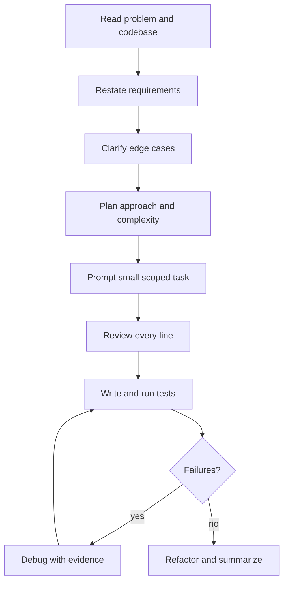

# 26 · AI-Assisted Coding Interviews

Study guide for interviews where AI tools are explicitly allowed and the interviewer evaluates how you prompt, review, test, debug, and explain. Formats change by company, so ask the recruiter what tools are allowed and never use AI where it is not permitted.

**Legend:** 🟢 Beginner · 🟡 Intermediate · 🔴 Advanced · ⚫ FAANG · 🔥 = very frequently asked

## Table of Contents
- [Format, Rubric, and Workflow](#format-rubric-and-workflow)
- [Prompting and Reviewing AI Code](#prompting-and-reviewing-ai-code)
- [Practice Rounds](#practice-rounds)
- [Discussion Questions](#discussion-questions)
- [Practice Plan and Integrity](#practice-plan-and-integrity)
- [Revision Cheat Sheet](#revision-cheat-sheet)
- [Flashcards](#flashcards)

## Format, Rubric, and Workflow

### Q1. What is an AI-assisted coding interview and how is it scored?
`🟢 Beginner` `🔥` `Must-know SDE-1`

**Why they ask:** You must know the game before practicing it.

**Short answer (say this first, 20-40 sec):**
It is a coding round where AI use is allowed and evaluated. Interviewers judge whether I understand the problem, prompt in small steps, review every line, test thoroughly, debug failures, and explain trade-offs instead of blindly accepting output.

**Detailed answer:**
Typical tasks include multi-file codebase changes, bug fixes, staged requirements, take-homes, and code review. Exact format varies by company; ask the recruiter.

| Area | Strong signal | Weak signal |
|---|---|---|
| Understanding | restates requirements and edge cases | prompts before reading |
| Planning | chooses approach and complexity first | lets AI design everything |
| Prompting | small, constrained prompts | vague giant prompts |
| Review | catches bugs and invented APIs | accepts code blindly |
| Testing | unit, edge, regression tests | only sample input |
| Debugging | uses traces and failures | reprompts randomly |
| Communication | narrates decisions | silent copy-paste |
| Judgment | knows when not to use AI | overuses AI |

**Common mistakes:**
- Treating the AI answer as authoritative.
- Not reading existing code before prompting.

**Follow-ups:**
- *Can I use AI in every round?* → No. Only when explicitly allowed.
- *What gets candidates rejected?* → Blind acceptance, no tests, poor explanation.

### Q2. What 9-step workflow should you follow?
`🟢 Beginner` `🔥` `Must-know SDE-1`

**Why they ask:** A repeatable workflow prevents chaos.

**Short answer (say this first, 20-40 sec):**
Read first, clarify, plan, prompt narrowly, review AI output, test, debug, refactor, and summarize. The AI is an assistant, not the owner of correctness.

**Detailed answer:**

Say out loud: "I will first inspect the existing code and tests so I do not ask the AI to break current behavior."

**Common mistakes:**
- Prompting before understanding.
- Asking AI for huge unreviewed diffs.

**Follow-ups:**
- *When do you stop prompting?* → When code is correct, tested, and explainable.
- *What if AI output is wrong?* → Debug the concrete failure, then ask a narrower follow-up.

### Q3. Give 10 bad-to-good prompt examples.
`🟡 Intermediate` `🔥` `Must-know SDE-1`

**Why they ask:** Prompt quality is now part of coding skill.

**Short answer (say this first, 20-40 sec):**
A good prompt includes context, goal, constraints, version, existing behavior, expected output, tests, and what not to change. It asks for a small result, not a magic full solution.

**Detailed answer:**
| Bad prompt | Good prompt |
|---|---|
| "Fix this." | "In Java 17, fix `UserService.findActiveUsers` so null status is ignored; do not change repository API; add JUnit tests." |
| "Write endpoint." | "Add Spring Boot 3 `GET /users/{id}` returning 404 via existing exception style; include MockMvc test." |
| "Optimize." | "Current loop is O(n²); propose O(n) using HashMap; preserve order; explain complexity." |
| "Make it secure." | "Review this JDBC query for SQL injection and rewrite with prepared parameters." |
| "Generate tests." | "Create tests for empty input, duplicates, null, overflow, and existing behavior." |
| "Use latest Spring." | "This project uses Spring Boot 3 and Jakarta imports; avoid javax." |
| "Add cache." | "Add bounded Caffeine cache around read-only lookup; invalidate on update." |
| "Debug error." | "Given this stack trace and failing test, identify root cause before code changes." |
| "Refactor all." | "Extract validation from this method only; keep public API unchanged." |
| "Build RAG." | "Fix Python retriever filter bug; use existing pgvector store and add one regression test." |

**Common mistakes:**
- Omitting language/framework version.
- Not saying what must not change.

**Follow-ups:**
- *Should you paste the whole repo?* → No; provide minimal relevant files and constraints.
- *How iterate?* → Point to exact failing test or line.

### Q4. What is the 60-second AI-code review checklist?
`🟢 Beginner` `🔥` `Must-know SDE-1`

**Why they ask:** Fast review prevents obvious AI mistakes.

**Short answer (say this first, 20-40 sec):**
Check requirements, boundaries, nulls, complexity, APIs, concurrency, security, existing behavior, tests, and readability before accepting AI code.

**Detailed answer:**
1. Does it solve the stated requirement only?
2. Empty, null, single, duplicate, large input?
3. Off-by-one and inclusive/exclusive bounds?
4. Complexity actually matches claim?
5. APIs/imports match project version?
6. Thread-safety and shared state?
7. SQL injection, secrets, validation?
8. Existing tests still pass?
9. New tests cover edge cases?
10. Can I explain every line?

**Common mistakes:**
- Running only the sample.
- Trusting AI complexity claims.

**Follow-ups:**
- *What first in Java?* → Nulls, collections, concurrency, and imports.
- *What first in Spring?* → validation, status codes, exception style, tests.

### Q5. What common AI mistakes should you catch in Java?
`🟡 Intermediate` `🔥` `Must-know SDE-1`

**Why they ask:** AI-generated Java often has subtle bugs.

**Short answer (say this first, 20-40 sec):**
Common issues are off-by-one errors, invented APIs, `javax` vs `jakarta`, bad complexity, HashMap races, SQL injection, missing null checks, and silently broken tests.

**Detailed answer:**
| Bug | AI output | Fix |
|---|---|---|
| Off-by-one | `for (int i=0;i<=arr.length;i++) sum+=arr[i];` | `i < arr.length` |
| Invented API | `list.first()` | `list.get(0)` or `Deque#getFirst` |
| javax vs jakarta | `import javax.validation.Valid;` in Boot 3 | `import jakarta.validation.Valid;` |
| O(n²) | nested search for each id | build `Map<Id, User>` |
| HashMap race | shared `HashMap` in parallel requests | `ConcurrentHashMap` or synchronize |
| SQL injection | `"where name='"+name+"'"` | prepared parameters |
| Null check | `user.getEmail().toLowerCase()` | validate `user` and email |
| Broken test | changed public behavior to fit new test | preserve existing test contract |

```java
// SQL fix
jdbcTemplate.query(
    "SELECT * FROM users WHERE email = ?",
    rowMapper,
    email
);
```

**Common mistakes:**
- Fixing only the visible example.
- Not checking project dependencies.

**Follow-ups:**
- *How catch invented APIs?* → Compile, inspect docs, and use IDE errors.
- *How catch complexity lies?* → Count loops and data structures.

### Q6. How do you navigate an unfamiliar codebase with AI allowed?
`🟡 Intermediate` `🔥` `Must-know SDE-1`

**Why they ask:** Many rounds use existing projects.

**Short answer (say this first, 20-40 sec):**
Find entry points, tests, package structure, data models, and failing behavior first. Ask AI to summarize small files or call paths, then verify by reading code and running tests.

**Detailed answer:**
- Start with README, build file, controllers, services, tests.
- Search for route, class, or method names.
- Run the smallest relevant tests.
- Use stack traces as evidence.
- Explain: "I am not asking AI to guess; I am using it to speed up navigation."

**Common mistakes:**
- Asking AI to rewrite before understanding architecture.
- Ignoring existing tests.

**Follow-ups:**
- *What if tests are absent?* → Add characterization tests for current behavior.
- *What if repo is huge?* → Trace one request path at a time.

## Practice Rounds

### Q7. Practice Round 1: LRU cache with hidden bug.
`🟡 Intermediate` `🔥` `Must-know SDE-1`

**Why they ask:** It tests review of AI-generated DSA code.

**Short answer (say this first, 20-40 sec):**
I would inspect invariants: capacity, get updates recency, put updates existing keys, and eviction removes the least recently used key from both list and map.

**Detailed answer:**
Task: implement LRU cache.  
AI's first answer bug:
```java
if (map.size() >= capacity) {
  Node old = tail.prev;
  remove(old);
}
map.put(key, node); // old key not removed from map
```
Notice: evicted node remains in map.  
Corrected code:
```java
if (map.size() >= capacity) {
  Node old = tail.prev;
  remove(old);
  map.remove(old.key);
}
```
What to say: "I am checking both data structures stay consistent."

**Common mistakes:**
- Testing only `put`.
- Forgetting update existing key.

**Follow-ups:**
- *Complexity?* → O(1) get and put.
- *Thread-safe?* → Not unless synchronized or guarded.

### Q8. Practice Round 2: Spring Boot endpoint with validation.
`🟡 Intermediate` `🔥` `Must-know SDE-1`

**Why they ask:** Backend rounds often modify APIs.

**Short answer (say this first, 20-40 sec):**
I would follow existing controller/service/repository patterns, validate input, return correct status codes, and add MockMvc tests.

**Detailed answer:**
Task: add `POST /users`.  
AI's first answer bug:
```java
@PostMapping("/users")
User create(@RequestBody UserRequest req) { return service.create(req); }
```
Notice: no `@Valid`, no status 201.  
Corrected code:
```java
import jakarta.validation.Valid;
import org.springframework.http.HttpStatus;
import org.springframework.web.bind.annotation.*;

@PostMapping("/users")
@ResponseStatus(HttpStatus.CREATED)
UserResponse create(@Valid @RequestBody UserRequest req) {
  return service.create(req);
}
```
What to say: "I matched Spring Boot 3 Jakarta validation and existing exception style."

**Common mistakes:**
- Returning entities directly.
- Missing validation tests.

**Follow-ups:**
- *Test?* → MockMvc invalid body returns 400.
- *Where business logic?* → Service layer.

### Q9. Practice Round 3: Race condition on shared HashMap.
`🔴 Advanced` `🔥` `Stretch`

**Why they ask:** AI often misses concurrency.

**Short answer (say this first, 20-40 sec):**
A shared `HashMap` is unsafe under concurrent writes. Use `ConcurrentHashMap`, synchronization, or make state request-scoped.

**Detailed answer:**
AI's first answer bug:
```java
private final Map<String, Integer> counts = new HashMap<>();
public void inc(String key) {
  counts.put(key, counts.getOrDefault(key, 0) + 1);
}
```
Corrected code:
```java
private final ConcurrentHashMap<String, LongAdder> counts = new ConcurrentHashMap<>();
public void inc(String key) {
  counts.computeIfAbsent(key, k -> new LongAdder()).increment();
}
```
What to say: "The original has lost updates and possible internal map corruption under concurrent access."

**Common mistakes:**
- Using `volatile HashMap`.
- Synchronizing reads but not writes.

**Follow-ups:**
- *Why LongAdder?* → Better under high contention.
- *Alternative?* → Database atomic update or synchronized method.

### Q10. Practice Round 4: AI gives O(n²), drive to optimal.
`🟡 Intermediate` `🔥` `Must-know SDE-1`

**Why they ask:** You must catch complexity lies.

**Short answer (say this first, 20-40 sec):**
I would identify nested loops, state the actual complexity, and ask for or implement a map/set-based O(n) solution.

**Detailed answer:**
Task: find two numbers adding to target.  
AI bug:
```java
for (int i = 0; i < nums.length; i++)
  for (int j = i + 1; j < nums.length; j++)
    if (nums[i] + nums[j] == target) return new int[]{i, j};
```
Corrected:
```java
Map<Integer, Integer> seen = new HashMap<>();
for (int i = 0; i < nums.length; i++) {
  int need = target - nums[i];
  if (seen.containsKey(need)) return new int[]{seen.get(need), i};
  seen.put(nums[i], i);
}
throw new IllegalArgumentException("no pair");
```
What to say: "This trades O(n) space for O(n) time."

**Common mistakes:**
- Believing AI's stated O(n).
- Missing duplicate values.

**Follow-ups:**
- *Space complexity?* → O(n).
- *Sorted input?* → Two-pointer O(1) extra space.

### Q11. Practice Round 5: Review SQL/JPA query.
`🔴 Advanced` `🔥` `Stretch`

**Why they ask:** Backend AI output can create performance and security bugs.

**Short answer (say this first, 20-40 sec):**
I check injection, N+1 queries, missing indexes, pagination, and transaction boundaries.

**Detailed answer:**
AI bug:
```java
@Query("select u from User u where u.email = '" + email + "'")
User find(String email);
```
Corrected:
```java
@Query("select u from User u where u.email = :email")
Optional<User> findByEmail(@Param("email") String email);
```
For N+1, use fetch join or entity graph where appropriate. Add an index on frequently filtered columns.

**Common mistakes:**
- Concatenating JPQL/SQL.
- Fetch-joining collections with pagination blindly.

**Follow-ups:**
- *How detect N+1?* → SQL logs and tests with multiple rows.
- *Index?* → `CREATE INDEX users_email_idx ON users(email);`

### Q12. Practice Round 6: Progressive key-value store.
`🔴 Advanced` `🔥` `Stretch`

**Why they ask:** Progressive requirements test maintainability.

**Short answer (say this first, 20-40 sec):**
I would design simple interfaces first, then add TTL, transactions, and persistence without rewriting everything.

**Detailed answer:**
Task levels: basic get/put/delete → TTL → transactions → persistence.  
AI first answer bug: stores TTL but never checks expiry on `get`.  
Corrected:
```java
record Entry(String value, long expiresAtMillis) {}
String get(String key) {
  Entry e = store.get(key);
  if (e == null) return null;
  if (e.expiresAtMillis() > 0 && e.expiresAtMillis() <= clock.millis()) {
    store.remove(key);
    return null;
  }
  return e.value();
}
```
What to say: "I inject `Clock` so TTL tests are deterministic."

**Common mistakes:**
- Using real sleep in tests.
- Mixing transaction state with committed state.

**Follow-ups:**
- *Persistence?* → Append-only log or snapshot.
- *Transactions?* → Staged writes then commit/rollback.

### Q13. Practice Round 7: Refactor messy AI-generated class.
`🟡 Intermediate` `🔥` `Must-know SDE-1`

**Why they ask:** AI code can be verbose and coupled.

**Short answer (say this first, 20-40 sec):**
I refactor only after tests pass, extract responsibilities, keep public behavior unchanged, and explain the new design.

**Detailed answer:**
AI bug: controller validates, maps DTO, calls repository, catches all exceptions, and formats response.  
Corrected shape:
```java
@RestController
class OrderController {
  private final OrderService service;
  @PostMapping("/orders")
  OrderResponse create(@Valid @RequestBody OrderRequest request) {
    return service.create(request);
  }
}
```
Move validation annotations to DTO, business rules to service, persistence to repository, errors to `@ControllerAdvice`.

**Common mistakes:**
- Large refactor without tests.
- Changing API response accidentally.

**Follow-ups:**
- *How verify?* → Existing tests plus snapshot/contract tests.
- *What not refactor?* → Unrelated code.

### Q14. Practice Round 8: Write tests for legacy class using AI.
`🟡 Intermediate` `🔥` `Must-know SDE-1`

**Why they ask:** AI is useful but misses edge cases.

**Short answer (say this first, 20-40 sec):**
Ask AI for test cases, then review gaps against requirements, boundaries, and current behavior before implementing.

**Detailed answer:**
AI first tests cover happy path only. Add:
```java
@Test
void returnsEmptyForNullInput() {
  assertEquals("", formatter.format(null));
}
@Test
void preservesExistingWhitespaceBehavior() {
  assertEquals("a  b", formatter.format("a  b"));
}
```
What to say: "I am adding characterization tests before changing legacy behavior."

**Common mistakes:**
- Testing implementation details.
- Letting AI change legacy behavior without approval.

**Follow-ups:**
- *What is characterization testing?* → Tests that capture current behavior before refactor.
- *When change behavior?* → Only with explicit requirement.

### Q15. Practice Round 9: Debug failing test suite in unfamiliar repo.
`🟡 Intermediate` `🔥` `Must-know SDE-1`

**Why they ask:** Debugging beats reprompting.

**Short answer (say this first, 20-40 sec):**
I read the failing assertion and stack trace, identify the smallest failing unit, reproduce locally, inspect recent changes, then fix root cause and run targeted tests.

**Detailed answer:**
AI first answer guesses "update expected value." Notice: failing test may reveal a real regression.  
Correct approach:
```java
// If service should reject negative amount:
if (amount.signum() < 0) {
  throw new IllegalArgumentException("amount must be non-negative");
}
```
What to say: "I will not update tests until I confirm the requirement changed."

**Common mistakes:**
- Changing tests to pass.
- Ignoring stack trace line numbers.

**Follow-ups:**
- *How use AI?* → Ask it to explain the stack trace, then verify.
- *What tests run?* → Targeted failing tests, then related suite.

### Q16. Practice Round 10: Fix Python RAG retrieval bug.
`🟡 Intermediate` `🔥` `Must-know SDE-1`

**Why they ask:** Connects to Lafz and Python.

**Short answer (say this first, 20-40 sec):**
I would check whether query embedding, filter metadata, distance metric, and top-k ordering match ingestion. Then add a regression test.

**Detailed answer:**
AI bug:
```python
docs = store.similarity_search(query, k=5, filter={"poet": poet.lower()})
```
If stored poet is title-case, filter misses rows. Correct:
```python
normalized_poet = normalize_poet(poet)
docs = store.similarity_search(query, k=5, filter={"poet_normalized": normalized_poet})
```
Regression test:
```python
def test_poet_filter_is_normalized():
    assert normalize_poet("Mirza Ghalib") == "mirza ghalib"
```
What to say: "The retrieval bug was metadata normalization, not the LLM."

**Common mistakes:**
- Blaming embeddings first.
- Not checking stored metadata.

**Follow-ups:**
- *How verify quality?* → Recall@K on labeled queries.
- *How avoid future bugs?* → Normalize at ingestion and query.

## Discussion Questions

### Q17. How do you use AI tools in daily work?
`🟢 Beginner` `🔥` `Must-know SDE-1`

**Why they ask:** They want responsible usage.

**Short answer (say this first, 20-40 sec):**
I use AI to speed up navigation, draft boilerplate, generate test ideas, explain unfamiliar code, and compare approaches. I still own correctness, security, and final review.

**Detailed answer:**
For Java/Spring tasks, I first read the existing code and tests, then ask targeted prompts like "add MockMvc tests for these edge cases." For AI projects like Lafz, I use AI to brainstorm evaluation cases but verify with metrics and tests.

**Common mistakes:**
- Saying "AI writes my code."
- Not mentioning verification.

**Follow-ups:**
- *Do you paste secrets?* → No.
- *Do you use it for DSA?* → Only in AI-allowed practice; keep unassisted skills sharp.

### Q18. How do you ensure AI-generated code is correct and secure?
`🟡 Intermediate` `🔥` `Must-know SDE-1`

**Why they ask:** Verification is the core skill.

**Short answer (say this first, 20-40 sec):**
I review every line, compile, run targeted tests, add edge-case tests, check complexity, validate dependencies/APIs, and scan for security issues like injection, secrets, and unsafe concurrency.

**Detailed answer:**
Use the 60-second checklist, then deeper review for high-risk code. For Spring Boot, check status codes, validation, `jakarta` imports, exception handling, and tests. For SQL, require parameterization and indexes.

**Common mistakes:**
- Trusting AI because tests pass once.
- Ignoring security.

**Follow-ups:**
- *What if code compiles but is wrong?* → Add edge and regression tests.
- *What if AI invents API?* → Check docs/build errors.

### Q19. Tell me about a time AI gave wrong code. How did you catch it?
`🟡 Intermediate` `🔥` `Must-know SDE-1`

**Why they ask:** They want a concrete behavior story.

**Short answer (say this first, 20-40 sec):**
Template: "AI suggested `[wrong code]`. I caught it by `[test/compile/review]`, identified `[root cause]`, and fixed it by `[correct approach]`."

**Detailed answer:**
Example: "For a Spring Boot 3 endpoint, AI used `javax.validation.Valid`. The build failed because Boot 3 uses `jakarta.validation.Valid`. I corrected the import and added a validation test to prevent regression."

**Common mistakes:**
- Giving a vague story.
- Blaming AI without explaining your verification.

**Follow-ups:**
- *What did you learn?* → Always specify project versions.
- *How prevent recurrence?* → Prompt constraints and tests.

### Q20. What are risks of AI-generated code in production?
`🟡 Intermediate` `🔥` `Must-know SDE-1`

**Why they ask:** Production risk awareness matters.

**Short answer (say this first, 20-40 sec):**
Risks include subtle bugs, outdated APIs, security vulnerabilities, licensing/policy issues, performance regressions, broken existing behavior, and overconfidence from plausible-looking code.

**Detailed answer:**
Mitigations: code review, tests, dependency checks, static analysis, secret scanning, performance tests, threat modeling, and human ownership. AI output should go through the same engineering bar as human code.

**Common mistakes:**
- Treating AI code as lower-risk boilerplate.
- Skipping review for generated tests.

**Follow-ups:**
- *Can AI-generated tests be wrong?* → Yes; review tests too.
- *Who owns defects?* → The engineer.

### Q21. When would you NOT use an AI assistant?
`🟢 Beginner` `🔥` `Must-know SDE-1`

**Why they ask:** Judgment and integrity matter.

**Short answer (say this first, 20-40 sec):**
I would not use AI where it is not allowed, with secrets or restricted data, for tasks I cannot review, for final security decisions, or when direct reasoning is faster and safer.

**Detailed answer:**
In interviews, I ask the recruiter or interviewer whether AI is allowed. In production, I follow company policy and never paste confidential code/data into unapproved tools.

**Common mistakes:**
- Saying "I use it for everything."
- Ignoring policy.

**Follow-ups:**
- *What about DSA rounds?* → Usually unassisted unless explicitly allowed.
- *What about private code?* → Only approved enterprise tools.

### Q22. How do you handle licensing, secrets, and company policy?
`🔴 Advanced` `🔥` `Stretch`

**Why they ask:** Compliance matters.

**Short answer (say this first, 20-40 sec):**
Use only approved tools, never paste secrets, avoid copying unknown licensed code, keep attribution/policy requirements, run secret scanning, and review generated code for originality and dependency licenses.

**Detailed answer:**
- Secrets: redact, use env vars, secret manager.
- Licensing: avoid verbatim code from unknown sources; prefer generated structure and official docs.
- Policy: follow company AI usage rules and data classification.

**Common mistakes:**
- Pasting API keys into prompts.
- Adding dependencies without license review.

**Follow-ups:**
- *What if AI suggests a library?* → Check license, maintenance, and security.
- *What if prompt needs context?* → Provide minimal sanitized snippets.

### Q23. How has AI changed debugging, testing, and review?
`🟡 Intermediate` `🔥` `Must-know SDE-1`

**Why they ask:** They want balanced maturity.

**Short answer (say this first, 20-40 sec):**
AI speeds up hypothesis generation, test-case brainstorming, and unfamiliar-code explanation. It does not replace reproducing bugs, reading stack traces, running tests, or understanding root cause.

**Detailed answer:**
Good use: "Here is a stack trace and method; list likely causes." Bad use: "Fix everything" without evidence. I prefer small experiments, targeted tests, and clear commit-sized changes.

**Common mistakes:**
- Reprompting instead of debugging.
- Accepting test changes without requirement changes.

**Follow-ups:**
- *Does AI make debugging easier?* → Faster, but only with disciplined verification.
- *What do you still do manually?* → Root-cause reasoning and final review.

### Q24. Will AI replace software engineers?
`🟢 Beginner` `🔥` `Must-know SDE-1`

**Why they ask:** They assess judgment, not prediction hype.

**Short answer (say this first, 20-40 sec):**
AI will automate parts of coding, but engineers are still needed to define problems, make trade-offs, ensure correctness, handle security, understand users, and operate systems. The role shifts toward higher leverage and stronger review skills.

**Detailed answer:**
Balanced answer: "AI is like a powerful junior pair programmer: fast, useful, and sometimes wrong. Strong engineers will use it to move faster while preserving engineering discipline."

**Common mistakes:**
- Saying "AI will replace everyone."
- Saying "AI is useless."

**Follow-ups:**
- *How are you preparing?* → Practicing both AI-assisted and unassisted coding.
- *What skill matters more?* → Problem decomposition and verification.

## Practice Plan and Integrity

### Q25. What weekly practice plan should you follow?
`🟢 Beginner` `🔥` `Must-know SDE-1`

**Why they ask:** Consistency beats cramming.

**Short answer (say this first, 20-40 sec):**
Practice both AI-assisted and unassisted coding. Use AI rounds for prompting/review/debugging, and keep DSA/System Design sharp without AI.

**Detailed answer:**
| Day | Practice |
|---|---|
| Monday | One unassisted DSA problem; explain complexity |
| Tuesday | AI-assisted bug fix in Java; write tests |
| Wednesday | Spring Boot endpoint + validation + MockMvc |
| Thursday | Code review AI-generated buggy snippets |
| Friday | Python/RAG retrieval debugging |
| Saturday | 60-min mock AI-assisted round |
| Sunday | Review mistakes, flashcards, recruiter/tool policy checklist |

**Common mistakes:**
- Practicing only with AI.
- Not timing sessions.

**Follow-ups:**
- *How score yourself?* → Use Q1 rubric.
- *How many mocks?* → At least 1-2 per week before interviews.

### Q26. What is the integrity note for interviews?
`🟢 Beginner` `🔥` `Must-know SDE-1`

**Why they ask:** Misuse can disqualify you.

**Short answer (say this first, 20-40 sec):**
Use AI only where explicitly allowed. If unclear, ask the recruiter or interviewer. In AI-free rounds, do not use AI; keep unassisted coding skills strong.

**Detailed answer:**
Say: "Before the round, I will confirm whether AI tools are allowed, which tools are allowed, whether internet is allowed, and whether generated code must be disclosed." This shows professionalism.

**Common mistakes:**
- Assuming AI is allowed because some companies have AI rounds.
- Hiding AI usage.

**Follow-ups:**
- *What if interviewer says no?* → Do the round unassisted.
- *What if tool is built into platform?* → Ask if it may be used.

### Q27. What should you say at the end of an AI-assisted round?
`🟢 Beginner` `🔥` `Must-know SDE-1`

**Why they ask:** Closing summary affects interviewer confidence.

**Short answer (say this first, 20-40 sec):**
Summarize the requirement, approach, tests run, complexity, AI suggestions accepted/rejected, and what you would improve with more time.

**Detailed answer:**
Template: "I implemented `[feature]` by `[approach]`. I reviewed the AI output for `[bugs]`, fixed `[issue]`, and added tests for `[cases]`. Complexity is `[time/space]`. With more time I would `[improvement]`."

**Common mistakes:**
- Ending with "it works" only.
- Not mentioning tests.

**Follow-ups:**
- *What if tests fail at end?* → Explain current diagnosis and next concrete step.
- *Should you mention AI?* → Yes, where allowed: describe how you verified it.

## Revision Cheat Sheet
- Ask whether AI is allowed; never assume.
- Read code and requirements before prompting.
- Plan complexity yourself first.
- Prompt small, constrained tasks with version and no-change rules.
- Review every line of generated code.
- Run targeted tests and add edge cases.
- Catch off-by-one, nulls, invented APIs, `javax` vs `jakarta`, O(n²), races, SQL injection.
- Debug with evidence; do not reprompt blindly.
- Keep unassisted DSA sharp.
- You own final correctness, security, and explanation.

## Flashcards
- AI-assisted round → Evaluates how you use and verify AI.
- Best first step → Read and restate requirements.
- Good prompt → Context, goal, constraints, examples, no-change rules.
- Biggest red flag → Blindly accepting output.
- 60-sec review → Requirements, boundaries, APIs, complexity, security, tests.
- Spring Boot 3 validation import → `jakarta.validation.Valid`.
- HashMap concurrency fix → `ConcurrentHashMap` or synchronization.
- SQL injection fix → parameterized query.
- Characterization test → Captures existing behavior before refactor.
- HIT principle → Human owns correctness.
- Integrity rule → Use AI only when allowed.
- Closing summary → approach, tests, complexity, trade-offs.
